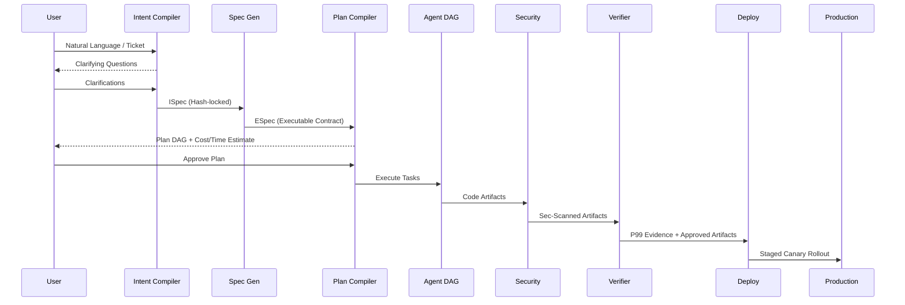
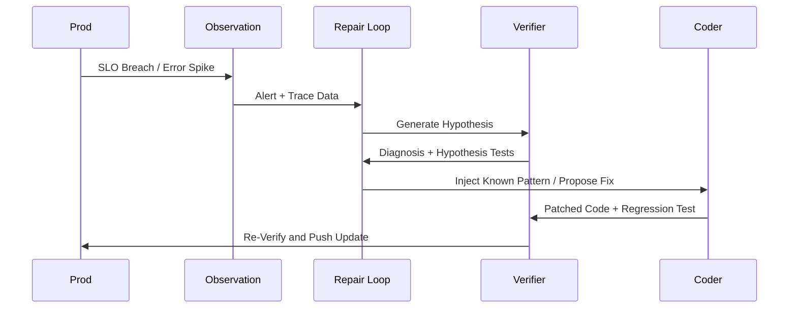
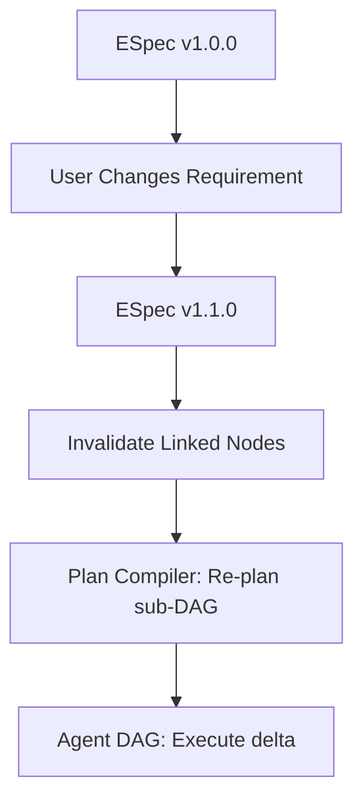

# G.O.D MACHINE v1.0 (2030 Sovereign Agentic Dev OS) Architecture

You are the chief systems architect for **G.O.D Machine 2030**, the ultimate sovereign, self-hosted Agentic Development Operating System that must outperform every existing system on every dimension: intent fidelity, specification rigor, plan quality, execution safety, verification depth, deployment reliability, observability, repair speed, sovereignty, cost, and developer experience.

## DESIGN PHILOSOPHY

G.O.D Machine is NOT a CI/CD pipeline with AI. It is NOT "GitHub Actions meets LLM." It is NOT "Kubernetes for coding agents." It is NOT a governance layer bolted onto Claude Code.

It is a **sovereign, self-hosted, intent-to-production operating system** where the entire software development lifecycle is orchestrated by a fleet of specialized agents under a deterministic verification kernel. The human is the INTENT PROVIDER and the FINAL AUTHORITY. The agents are the WORKFORCE. The kernel is the LAW.

The pipeline is the constitution:
**Intent → Specification → Plan → Agent DAG → Model Selection → Tool Selection → Secure Execution → Tests → Security → Verification (P99) → Deployment → Observation → Repair**

Every stage is GATED. No stage completes without EVIDENCE. The kernel enforces the gates. The LLM cannot skip them.

---

## 1. INTENT CAPTURE (The "What Do You Actually Want?" Problem)

### Pain points solved:
- "Vibe coding" produces code that doesn't match intent (IBM, 2025)
- "The agent builds what it THINKS you want, not what you SAID you want"
- "Prompt-to-code gap: the natural language request and the generated code diverge silently"
- "No structured intent: 'build me a REST API' is 1000 different systems depending on interpretation"
- "Intent decay: by step 15 of 20, the agent has forgotten constraint #3 from the original request"
- "No non-goals: the agent adds features you never asked for"
- "No acceptance criteria: 'done' means different things to the agent and the human"
- "The specification is a prompt, not a contract"
- "Intent is lost in context: 40K tokens later, the original goal is buried"

### G.O.D Machine solution — "Intent Compiler (IC)":

1. **Intent as a Typed, Verifiable Artifact (Not a Prompt)**
   - The human's intent is NOT a free-text prompt. It is **compiled** into a structured **Intent Specification (ISpec)**.
   - **The IC (Intent Compiler) is a multi-step process:**
     1. **Capture:** Human provides intent (voice, text, markdown, Jira ticket, GitHub issue — any format).
     2. **Clarify:** The system asks structured questions (max 5) to resolve ambiguity.
     3. **Compile:** The ISpec is generated. The human REVIEWS and APPROVES it. It is now a CONTRACT.
     4. **Lock:** The ISpec is hash-locked. Any subsequent deviation from it is flagged.

2. **Intent Fidelity Tracking (End-to-End)**
   - Every downstream artifact (spec, plan, code, test, deployment) carries a **traceability link** back to the ISpec.
   - **Fidelity Score:** At every stage, the kernel computes: "How well does the current output satisfy the ISpec?"
   - If fidelity drops below threshold (0.8), the pipeline HALTS and escalates.

---

## 2. SPECIFICATION (The "Living Document" Problem)

### Pain points solved:
- "Specs decay: written at the start, never updated, contradict the code by week 2" (O'Reilly, 2026)
- "The spec is a one-time artifact, not a living document"
- "No single source of truth: the spec, the code, the tests, and the docs all disagree"
- "Spec-driven development (Intent, BuilderMethods) is promising but the spec is still a markdown file, not an executable contract"
- "No machine-verifiable spec: 'the API should be fast' is not a spec"
- "Spec changes after code is written = cascade of rework with no traceability"

### G.O.D Machine solution — "Executable Specification (ES)":

1. **The Spec IS the Code's Contract (Executable)**
   - The Specification is NOT a markdown document. It is a **machine-verifiable, executable contract**.
   - **The ESpec is the SINGLE SOURCE OF TRUTH.** Code, tests, docs, and deployment are all DERIVED from it. If the code doesn't match the ESpec, the code is wrong (not the spec).
   - **Spec changes are VERSIONED** (e.g., `v1.0.0` → `v1.1.0`). Every change requires: re-approval, re-verification, cascade invalidation of dependent artifacts.

2. **Spec-to-Code Traceability (Bidirectional)**
   - **Forward:** ESpec → Plan → Code → Tests → Deployment. Every artifact links to its spec section.
   - **Backward:** Code → ESpec. Every code file has a header mapping to the spec.
   - **The kernel can answer:** "What code implements G1?" / "What spec section does this test verify?"

---

## 3. PLAN GENERATION (The "How Do We Build It?" Problem)

### Pain points solved:
- "LLM planning is brittle: one-shot plans assume a perfect world where tools always succeed" (arxiv 2509.08646)
- "No dynamic re-planning: the plan is static, execution adapts ad-hoc"
- "Plan doesn't account for dependencies: 'write the API' before 'design the DB schema'"
- "No parallelism in the plan: everything is sequential when 60% could be parallel"
- "Plan doesn't estimate cost or time: 'it'll take a while' is not a plan"
- "No failure paths in the plan: what happens if the Stripe API is down? If the DB migration fails?"
- "The plan is a prompt, not an executable DAG"

### G.O.D Machine solution — "Plan Compiler (PC)":

1. **Plan as a Verifiable, Executable DAG**
   - The Plan is a **Directed Acyclic Graph** where:
     - Nodes = tasks (with: input contract, output contract, estimated cost, estimated time, failure policy)
     - Edges = dependencies (data flow, ordering)
     - Parallelism = nodes with no dependency between them run concurrently
   - **The Plan is COMPILED, not generated:** The LLM proposes the decomposition; the Plan Compiler VALIDATES it.
   - **The Plan is REVIEWED by the human** before execution.

2. **Dynamic Re-Planning (Kernel-Triggered)**
   - The Plan DAG is NOT static. The kernel can trigger re-planning:
     - **On failure:** If a node fails, the kernel re-invokes the Planner for the affected subgraph.
     - **On spec change:** If the ESpec is updated, the kernel invalidates dependent nodes and re-plans the affected subgraph.
     - **On resource constraint:** If the budget is tight, the kernel re-plans with a tighter budget.
   - **Re-planning is bounded:** Max 3 re-plans per task.

3. **Plan Cost & Time Estimation (Deterministic)**
   - Every node in the DAG has estimated tokens, cost, time, and confidence.
   - Total plan estimate is calculated with parallelism adjustment for time.
   - If actual cost/time exceeds estimate by > 50%, the kernel alerts and may halt.

---

## 4. AGENT DAG EXECUTION (The "Who Does What?" Problem)

### Pain points solved:
- "Context leakage: agents see each other's full context, causing confusion and token waste" (Augment, 2026)
- "Conflicting edits: two agents modify the same file, merge conflict"
- "No workspace isolation: agents share the same filesystem, step on each other"
- "Agent specialization is fake: one 'generalist' agent does everything"
- "No per-agent model selection: the 'smart' model is used for everything, wasting cost"
- "Coordination overhead: more agents = more messages = more cost"
- "Agent failure cascades: one agent fails, the whole pipeline stops"

### G.O.D Machine solution — "Specialized Agent DAG (SAD)":

1. **Agent Roles (Fixed, Specialized)**
   - The G.O.D Machine has a FIXED set of specialized agents: Architect, Coder, Tester, Security, Performer, DevOps, DocWriter, Verifier.
   - **Each agent has:** Its own context window, tool set, model binding, cost budget, and workspace (git worktree).

2. **Workspace Isolation (Git Worktrees)**
   - Each agent works in its own **git worktree**.
   - **Merge is controlled:** The kernel merges worktrees in dependency order. Conflicts are detected BEFORE merge via AST comparison.

3. **Agent Communication (Structured, Minimal)**
   - Agents do NOT "chat." They exchange **structured artifacts**.
   - **The kernel routes artifacts.** Agents don't "send messages." Only the structured artifact is passed.

4. **Failure Containment**
   - If an agent fails, its worktree is preserved. The kernel checks if the DAG can continue. If no, triggers re-planning. One agent's failure does NOT cascade.

---

## 5. MODEL SELECTION (The "Which Brain for Which Task?" Problem)

### Pain points solved:
- "One model for everything: the expensive frontier model is used for formatting code AND for architectural decisions"
- "No per-task model routing: the model is chosen at session start, not per task"
- "Model capability mismatch: a 7B model is asked to design a distributed system"
- "No fallback: if the primary model fails, the task fails"
- "Model deprecation: the model you're using gets deprecated, your pipeline breaks"
- "No cost-aware routing: the cheapest model that CAN do the task is not always selected"

### G.O.D Machine solution — "Model Router (MR)":

1. **Task-Complexity-Based Routing (Deterministic)**
   - Every task in the Plan DAG is tagged with a **complexity score** (1-10) which maps to a model tier (Tier 1 local, Tier 2 API mid, Tier 3 API frontier). The router is deterministic.

2. **Capability-Aware Selection**
   - The router considers code generation quality, reasoning quality, tool-use reliability, and context window to select the BEST model for the task.

3. **Fallback Chain (Per-Task)**
   - Every task has a **model fallback chain**. If the primary model fails, the router automatically falls back, with quality gates if the fallback is a lower tier.

4. **Model Health Monitoring**
   - The router continuously monitors model health (latency, error rate, etc.). If a model degrades, traffic shifts to the next model in the chain.

---

## 6. TOOL SELECTION (The "What Can the Agent Touch?" Problem)

### Pain points solved:
- "Agents have access to ALL tools by default: file system, shell, network, database — no scoping"
- "Tool selection is LLM-decided: the agent 'chooses' which tool to use, which is non-deterministic"
- "No tool sandboxing: the agent can `rm -rf /`"
- "Credential management: API keys in environment variables, visible to the agent"
- "Tool output is unvalidated: the agent trusts the tool's output without checking"
- "No tool versioning: a tool update breaks the agent's workflow"

### G.O.D Machine solution — "Tool Fabric (TF)":

1. **Per-Task Tool Scoping (Kernel-Enforced)**
   - Each task in the Plan DAG declares its **tool requirements**. The kernel enforces this scope.

2. **Deterministic Tool Routing (Not LLM-Chosen)**
   - The kernel determines which tool to use based on the task's declared requirements. The LLM produces the INTENT; the kernel maps it to the specific tool call. Tool selection is logged and auditable.

3. **Tool Sandboxing (Mandatory)**
   - All tools run in isolated sandboxes (e.g., gVisor, Firecracker, FUSE overlay, Network namespaces). Every tool output is schema-validated before entering the agent's context.

4. **Credential Injection (Agent Never Sees Secrets)**
   - API keys are NEVER in the agent's context. They are injected at the system level when the tool makes the actual call. The agent sees the result, not the credential.

---

## 7. SECURE EXECUTION (The "Can I Trust This Code?" Problem)

### Pain points solved:
- "AI-generated code has security vulnerabilities: SQL injection, XSS, hardcoded secrets, insecure dependencies"
- "The agent introduces vulnerabilities it doesn't know it's introducing"
- "No security review before execution: the code runs, THEN you scan it"
- "Supply chain: the agent adds a dependency with a known CVE"
- "No secrets detection: the agent hardcodes an API key in the code"
- "No input validation: the agent writes an endpoint without sanitizing user input"

### G.O.D Machine solution — "Secure Execution Kernel (SEK)":

1. **Pre-Execution Security Gate (Mandatory)**
   - Before ANY code is executed, it passes through a **deterministic security pipeline** (Static Analysis, Secrets Detection, Dependency Audit, Input Validation Check, Authorization Check). If ANY gate fails, the code is NOT executed.

2. **Runtime Security (During Execution)**
   - During development/testing, network egress is logged, filesystem access is scoped, database access is read-only, and no production credentials are available.

3. **Security Agent (Dedicated, Adversarial)**
   - The Security agent runs an **adversarial review** after the Coder agent produces code. Findings are MANDATORY to fix before the Verification stage.

---

## 8. TESTS (The "Does It Actually Work?" Problem)

### Pain points solved:
- "AI-generated tests are shallow: they test the happy path, not edge cases"
- "No test strategy: the agent writes whatever tests come to mind"
- "Test coverage is a vanity metric: 90% coverage with meaningless assertions"
- "No property-based testing: the agent doesn't think about invariants"
- "No integration testing: unit tests pass but the system doesn't work end-to-end"
- "Tests are written AFTER the code, not derived from the spec"

### G.O.D Machine solution — "Test Compiler (TC)":

1. **Tests Derived from the ESpec (Not from the Code)**
   - The Tester agent **derives tests from the ESpec** (acceptance criteria, behavioral invariants, performance requirements, security requirements). The test suite is COMPLETE relative to the spec.

2. **Multi-Layer Test Strategy (Mandatory)**
   - Every feature must have tests at ALL layers: Unit, Integration, Contract, Property, Performance, Security, E2E. The kernel checks: are ALL layers present?

3. **Test Quality Enforcement (Not Just Coverage)**
   - The kernel checks test QUALITY (assertion density, edge case coverage, mutation testing, flakiness detection), not just quantity.

---

## 9. SECURITY (The "Is It Actually Secure?" Problem)

### Pain points solved:
- "Security is an afterthought: scan at the end, fix what you find"
- "No threat model: the agent doesn't think about attack vectors"
- "OWASP Top 10 is a checklist, not a process"
- "No security testing in CI: the code ships, THEN you scan it"
- "No penetration testing: the agent can't simulate an attacker"

### G.O.D Machine solution — "Security Verification Pipeline (SVP)":

1. **Threat Model (Before Code, Not After)**
   - The Security agent generates a **threat model** BEFORE implementation. Every threat has a mitigation AND a mandatory test.

2. **Automated Penetration Testing (Continuous)**
   - The Security agent runs **automated pen tests** against the development instance (DAST scan, custom attack scripts, fuzzing, dependency scanning). Results are MANDATORY to address.

3. **Security Score (Quantitative)**
   - The system computes a **Security Score** (0-100). Threshold: >= 95 required for Verification to pass.

---

## 10. VERIFICATION (P99) (The "Does It Meet the Spec AT SCALE?" Problem)

### Pain points solved:
- "Tests pass in development but fail in production (different scale, different data, different concurrency)"
- "No performance verification: the code works but is too slow under load"
- "No P99 verification: average latency is fine, P99 is terrible"
- "No verification against the spec: the code 'works' but doesn't meet the acceptance criteria"
- "Verification is manual: a human looks at the code and says 'looks good'"
- "No evidence: 'I tested it and it works' is not verification"

### G.O.D Machine solution — "P99 Verification Engine (PVE)":

1. **Verification = Evidence, Not Opinion**
   - The Verifier agent **collects evidence** that the system meets the ESpec. Every "PASS" has EVIDENCE. If ANY item is "FAIL", the entire verification FAILS.

2. **P99 Performance Verification (Not Average)**
   - The PVE runs **production-scale load tests** (sustained, mixed workload). The P99 is the GATE. If P99 > threshold, verification FAILS regardless of average performance.

3. **Spec Compliance Check (Deterministic)**
   - The PVE runs a **deterministic spec compliance check** (OpenAPI schema diff, DB schema diff, environment variables diff, dependencies diff). Any deviation = FAIL.

---

## 11. DEPLOYMENT (The "How Does It Get to Production?" Problem)

### Pain points solved:
- "Deployment is manual: the agent writes the code, a human deploys it"
- "No deployment verification: the code deploys, THEN you check if it works"
- "No rollback: if the deployment breaks, you manually revert"
- "No canary: the new version goes to 100% of users immediately"
- "No smoke tests in production: the deployment is 'done' when the container starts"
- "Infrastructure as code is separate from the agent: the agent writes code, a human writes Terraform"

### G.O.D Machine solution — "Deployment Pipeline (DP)":

1. **Automated, Verified Deployment**
   - The DevOps agent executes the deployment: Build → Stage → Smoke Test → Canary → Monitor → Promote → Verify. Each step is GATED with automatic rollback on failure.

2. **Infrastructure as Code (Agent-Generated)**
   - The DevOps agent generates IaC (Terraform/Pulumi) FROM the ESpec. The IaC is versioned, reviewed, and applied automatically.

3. **Deployment Evidence**
   - Every deployment produces a **Deployment Report** with metrics, smoke test results, and rollback triggers.

---

## 12. OBSERVATION (The "Is It Healthy in Production?" Problem)

### Pain points solved:
- "No observability: the code deploys and you hope it works"
- "Logs are unstructured: 'grep the logs' is not observability"
- "No SLO tracking: you don't know if the system is meeting its performance contract"
- "No alerting: you find out about problems when users complain"
- "No cost monitoring: you don't know what the system costs to run"

### G.O.D Machine solution — "Observation Fabric (OF)":

1. **Structured Observability (From Day 1)**
   - The Coder agent is REQUIRED to instrument the code with structured logs, metrics, and traces. The kernel checks this; if missing, Verification FAILS.

2. **SLO Tracking (Continuous)**
   - The system continuously tracks SLOs (from the ESpec) with burn rate alerting.

3. **Cost Monitoring (Continuous)**
   - Real-time cost tracking of infrastructure and API calls, with alerts against projected budgets.

---

## 13. REPAIR (The "It Broke, Now What?" Problem)

### Pain points solved:
- "Incident response is manual: a human reads the alert, investigates, writes a fix, deploys it"
- "No automated diagnosis: 'the P99 went up' but why?"
- "No automated repair: the fix requires a human"
- "No post-mortem: the same bug happens again next month"
- "No regression test: the fix works but there's no test to prevent recurrence"
- "Mean time to recovery (MTTR) is hours, not minutes"

### G.O.D Machine solution — "Self-Healing Repair Loop (SHRL)":

1. **Automated Diagnosis (Sub-Minute)**
   - When an SLO is breached, the kernel correlates the alert, the Verifier generates hypotheses, runs targeted tests, and produces a structured diagnosis. Time to diagnosis: < 5 minutes.

2. **Automated Repair (For Known Patterns)**
   - For known failure patterns, the kernel applies the known fix automatically. Time to repair: < 15 minutes. Unknown patterns escalate to a human.

3. **Post-Mortem + Regression Test (Mandatory)**
   - After EVERY incident, the Verifier generates a Post-Mortem, the Tester writes a mandatory Regression Test, the ESpec is updated, and the fix is added to the Pattern Library. The system LEARNS from every incident.

---

## 14. SOVEREIGNTY & SELF-HOSTING (The "Do I Own This?" Problem)

### Pain points solved:
- "Cloud dependency: the agent needs OpenAI/Anthropic API to function. If the API is down, the system is down"
- "Data sovereignty: your code is sent to a third-party API. For regulated industries, this is a dealbreaker"
- "Vendor lock-in: the system is built around one provider's API. Switching means rewriting"
- "No offline mode: if the internet is down, the agent can't work"
- "No air-gapped deployment: for defense, finance, healthcare, you need to run without external connectivity"

### G.O.D Machine solution — "Sovereign Execution (SE)":

1. **Local-First, Cloud-Optional**
   - The G.O.D Machine runs FULLY locally by default (Ollama/llama.cpp/vLLM). Cloud models are OPTIONAL for Tier 3 and system degrades gracefully if unavailable.

2. **Air-Gapped Deployment**
   - Supports full air-gapped operation (single binary + model files + vendored dependencies). Zero data leaves the machine.

3. **Model Portability (No Lock-In)**
   - Model-agnostic by design. Switching providers is one config change.

4. **Data Sovereignty (Zero External Data Flow)**
   - Default: zero data leaves the machine. Optional: encrypted sync. Designed to meet compliance (GDPR, HIPAA, FedRAMP, SOX) by default.

---

## 15. DEVELOPER EXPERIENCE (The "Is It Actually Usable?" Problem)

### Pain points solved:
- "Complex setup: Docker, K8s, 12 environment variables, 3 config files"
- "The operator has to understand the agent framework to use it"
- "No feedback loop: the agent is working, but you don't know what it's doing"
- "Error messages are unhelpful: 'Agent failed at step 7' with no context"
- "The system is a black box: you give it a prompt, code appears, you don't know what happened in between"

### G.O.D Machine solution — "Zero-Config, Transparent Operation":

1. **One-Command Setup**
   - `god-machine init` sets up everything in < 10 minutes. No Docker, no K8s, no YAML.

2. **The Pipeline Dashboard (Real-Time)**
   - A local web UI (or TUI) shows the pipeline in real-time. The operator sees everything.

3. **Actionable Error Messages**
   - Errors explain what happened, why, and the exact fix or action being taken (e.g., AUTO-REPAIRING).

---

## IMPLEMENTATION CONSTRAINTS

- **Core language:** Rust (kernel, scheduler, tool fabric, security gates) + Python (agent runtime, LLM glue, test framework) + TypeScript (dashboard UI)
- **Local models:** Ollama / vLLM / llama.cpp. Default: Llama 4 14B or 70B.
- **Memory:** SQLite (local state) + Parquet (evidence) + Apache Jena (knowledge graph)
- **Sandbox:** gVisor (tool execution) + Firecracker (microVM) + FUSE (filesystem overlay)
- **Deployment:** Single binary (cross-compiled) + model files + vendored dependencies.
- **Hardware (minimum):** 8-core CPU, 32GB RAM, 100GB SSD.
- **Hardware (recommended):** 16-core CPU, 64GB RAM, NVMe SSD, 1× GPU (16GB+ VRAM).
- **Hardware (enterprise):** Multi-node, GPU cluster, CXL memory pool, RDMA fabric.
- **Languages supported (day 1):** Python, TypeScript, Rust, Go, Java
- **Languages supported (Q2 2030):** C, C++, Ruby, PHP, Kotlin, Swift

---

## SUCCESS CRITERIA (vs. 2026 Systems)

| Dimension | 2026 Best | G.O.D Machine Target |
|-----------|-----------|---------------------|
| Intent fidelity | "Prompt to code" (lossy) | Compiled ISpec, hash-locked, traceable |
| Specification | Markdown file (decays) | Executable ESpec, versioned, machine-verifiable |
| Plan quality | LLM-generated list (brittle) | Compiled DAG, validated, parallel, with failure paths |
| Agent specialization | 1 generalist (or fake roles) | 8 specialized agents, isolated workspaces |
| Model selection | 1 model for all | Per-task routing, capability-aware, fallback chain |
| Tool security | "Configure it yourself" | Kernel-enforced scoping, sandboxing, credential-free |
| Pre-execution security | "Scan after you ship" | 5-gate deterministic pipeline, mandatory |
| Test quality | "Write some tests" | 7-layer strategy, derived from spec, quality-enforced |
| Security verification | "OWASP checklist" | Threat model + automated pen test + security score |
| Verification | "I tested it, looks good" | P99 evidence-based, deterministic spec compliance |
| Deployment | "Human deploys it" | Automated canary, smoke-tested, auto-rollback |
| Observability | "Grep the logs" | Structured, SLO-tracked, cost-monitored |
| Repair | "Human investigates for hours" | Auto-diagnosis < 5min, auto-repair < 15min |
| Learning | "Same bug next month" | Post-mortem + regression test + pattern library |
| Sovereignty | "Send code to OpenAI" | Local-first, air-gapped, zero data exfiltration |
| Setup time | "Docker + K8s + 12 env vars" | `god-machine init` → < 10 min |
| Cost (typical feature) | $50-200 (API) | $10-35 (local-first) |
| Time (typical feature) | 4-8h (human + agent) | 2-4h (fully autonomous) |
| MTTR (production incident) | Hours (manual) | < 15 min (automated) |
| Vendor lock-in | High (API-specific) | Zero (model-agnostic, local-first) |
| Air-gapped operation | Not possible | Full (single binary + local models) |

---

## FINAL INSTRUCTION ARTIFACTS

### Component Diagram

```mermaid
graph TD
    User([Human Authority]) --> |Intent| IC(Intent Compiler)
    IC --> |ISpec| SG(Specification Generator)
    SG --> |ESpec| PC(Plan Compiler)
    PC --> |Plan DAG| MR(Model Router)
    MR --> |Tasks| ADE(Agent DAG Executor)

    subgraph Agent Workforce
        ADE --> Arch[Architect]
        ADE --> Code[Coder]
        ADE --> Test[Tester]
        ADE --> Sec[Security]
        ADE --> Perf[Performer]
    end

    Code --> |Tool Requests| TF(Tool Fabric)
    Test --> |Tool Requests| TF

    subgraph Sandboxed Tools
        TF --> FileIO(File I/O Sandbox)
        TF --> Shell(Shell MicroVM)
        TF --> DB(Database Sandbox)
    end

    Agent Workforce --> |Code Artifacts| SGates(Security Gates)
    SGates --> |Verified Artifacts| VE(Verification Engine)
    VE --> |P99 Evidence| DP(Deployment Pipeline)

    DP --> |Deployed Service| OF(Observation Fabric)
    OF --> |Alerts/Metrics| RL(Repair Loop)
    RL --> |Diagnosis/Patch| PC
```

### Data Flow Diagrams

**Intent → Production Lifecycle**


**Failure → Repair Loop**


**Spec Change → Cascade**


### Threat Model

Designed assuming fully hostile environments, malicious dependencies, and compromised LLMs.

| Threat | Description | Mitigation (Deterministic) |
|---|---|---|
| **Prompt Injection** | User or external data injects commands causing agent malfunction. | Kernel restricts agent output to typed schemas. Agents do not execute actions; they request them. Tool Fabric sandbox rejects unsanctioned actions. |
| **Tool Abuse** | Compromised agent attempts to `rm -rf /` or leak data. | MicroVM (Firecracker) / gVisor isolation. Scoped File I/O. Zero external network egress by default. Kernel blocks out-of-scope tool requests. |
| **Data Exfiltration** | Agent attempts to send proprietary code to a third-party API. | Fully air-gapped system. Local models. No network tool access without explicit ESpec requirement. |
| **Supply Chain** | Agent pulls dependency with a zero-day or known CVE. | 5-gate pre-execution security pipeline (Snyk + OSV). Lockfile diffing against allowed organizational lists. |
| **Model Manipulation** | Model hallucinates verification success or overrides policies. | Verification is deterministic (P99 Engine), not LLM-based. Evidence is cryptographic (hashes, test results), never subjective. |
| **Verification Bypass** | Agent manually edits the `p99_latency` report to pass tests. | Evidence is collected externally by the Verification Engine (Tier 3 isolate) and signed. Agents lack write access to the evidence database. |

### Component Specifications

**ISpec (Intent Specification)**
* **Schema:** YAML/JSON with `intent_id`, `goals`, `non_goals`, `constraints`, `quality_thresholds`, `budget`, and `context`.
* **Validation Rules:** Must contain at least one measurable goal, zero contradiction in constraints, and explicitly bounded budget.
* **Compilation Algorithm:** Parse input -> Extract structural properties -> Clarify ambiguity (query human max 5 times if score > 0.1) -> Compile YAML -> Hash-lock output (SHA-256).

**ESpec (Executable Specification)**
* **Schema:** `spec_id`, `version`, `api` (OpenAPI 3.1), `data` (table definitions/RLS), `behavior` (test invariants), `performance` (P99 bounds), `security` (auth/encryption).
* **Versioning Rules:** Semantic versioning (Minor = additive, Major = breaking/schema changes). Changes trigger cascade invalidation of downstream DAG nodes.
* **Traceability Format:** Every downstream file/AST node must carry a header mapping to an ESpec section (e.g., `# Spec: SPEC-1023 §api.paths./v1/subscriptions`).

**Plan DAG Specification**
* **Node Types:** `design`, `implement`, `test`, `audit`, `verify`, `deploy`.
* **Edge Types:** `depends_on`, `provides_data`, `blocks`.
* **Validation Rules:** DAG must be acyclic. Total estimated cost/time must be < ESpec budget. Every ESpec requirement must map to at least one terminal verification node.
* **Re-planning Protocol:** Max 3 retries per node. On failure, invalidate subgraph and query Tier 3 model for new approach. Halt and escalate to human after 3 failures.

**Agent DAG Specification**
* **Agent Roles:** Architect, Coder, Tester, Security, Performer, DevOps, DocWriter, Verifier.
* **Workspace Isolation:** One git worktree per agent. Merges are kernel-mediated AST-level merges.
* **Communication Protocol:** Agents exchange typed artifacts (e.g., `api_contract.yaml`, `test_failures.json`). No direct context sharing or free-text chat.
* **Failure Containment:** If node fails, tree prunes, replans isolated subtree without crashing sibling nodes.

**Tool Fabric Specification**
* **Tool Types:** `file.read`, `file.write`, `shell.exec`, `db.query`, `net.request`.
* **Sandboxing:** MicroVM (Firecracker) for shell/network. FUSE overlays for file I/O.
* **Credential Injection:** Agents request actions using symbolic handles (e.g., `$STRIPE_KEY`). Tool Fabric resolves the secret from the local vault *inside* the execution sandbox. Agent never sees the literal secret.
* **Output Validation:** All tool stdout/stderr is schema-validated before returning to agent context.

**Security Gate Specification (SEK)**
* **5 Gates:**
    1. Static Analysis (Semgrep, CodeQL) - Threshold: 0 Critical, 0 High.
    2. Secrets Detection (TruffleHog) - Threshold: 0 findings.
    3. Dependency Audit (OSV) - Threshold: 0 known CVEs.
    4. Input Validation Check (AST rules) - Threshold: 100% of endpoints typed.
    5. Authorization Check (AST rules) - Threshold: 100% of endpoints protected.
* **Evidence Format:** Signed JSON artifact containing tool outputs, hashes of scanned files, and pass/fail booleans.

**Verification Engine Specification (PVE)**
* **Evidence Format:** Immutable Parquet files containing raw metrics, assertions passed, and timestamps.
* **P99 Methodology:** Load generators sustain 10K concurrent connections (or ESpec defined) for 30 minutes. Average latency is ignored. If P99 > threshold, verification fails.
* **Spec Compliance Algorithm:** Deterministic AST/Schema diffing. Does OpenAPI generated from codebase == ESpec OpenAPI? If diff != 0, fail.

**Deployment Pipeline Specification (DP)**
* **Stages:** Build -> Stage -> Smoke Test -> Canary (5%) -> Monitor -> Promote (100%).
* **Gates:** PVE success, SEK success, User Approval (if AUTONOMOUS mode is not set).
* **Rollback Triggers:** P99 > threshold, Error Rate > 0.1%, CPU > 90% during canary.
* **Canary Metrics:** 15-minute rolling window tracking latency and HTTP 5xx codes against the baseline.

**Repair Loop Specification (SHRL)**
* **Diagnosis Algorithm:** Correlate SLO breach with recent commits. Verifier generates hypothesis. Sub-DAG spawned to reproduce bug locally.
* **Pattern Library Format:** RDF/Knowledge graph storing `{Symptom, Root Cause, AST Patch}` (e.g., N+1 query -> apply eager loading).
* **Regression Test Generation:** Tester agent MUST write an invariant test that fails without the patch and passes with it. Mandatory addition to ESpec.

### 24-Month Build Roadmap

* **Phase 1: The Sovereign Kernel (Months 1-6)**
  * **Milestones:** Core Rust kernel, Intent Compiler, basic ESpec generation, local model integration (Ollama/llama.cpp), Firecracker sandbox integration.
  * **Hardware Gate:** Operable on 32GB RAM (14B local models).
  * **Language Support:** Python.
* **Phase 2: Agent DAG & Security (Months 7-12)**
  * **Milestones:** 8-agent swarm implementation, strict workspace isolation (git worktrees), 5-Gate pre-execution security pipeline, Model Router fallback chains.
  * **Hardware Gate:** Operable on 64GB RAM or 1x GPU (70B local models).
  * **Language Support:** TypeScript, Rust.
* **Phase 3: P99 Verification & Deployment (Months 13-18)**
  * **Milestones:** P99 Verification Engine, load testing synthesis, deterministic spec diffing, Canary deployment pipelines, IaC (Terraform) generation.
  * **Hardware Gate:** Enterprise Multi-node capability for load generation.
  * **Language Support:** Go, Java.
* **Phase 4: Self-Healing & Mastery (Months 19-24)**
  * **Milestones:** Observation Fabric integration, sub-minute automated diagnosis, pattern library (knowledge graph), automated regression test enforcement.
  * **Hardware Gate:** CXL memory pool / RDMA fabric (Enterprise scale).
  * **Language Support:** C, C++, Kotlin, Swift.