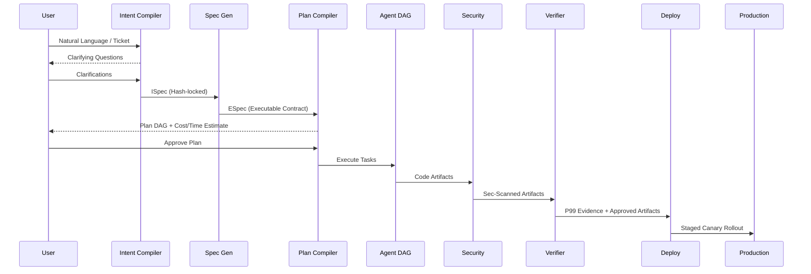
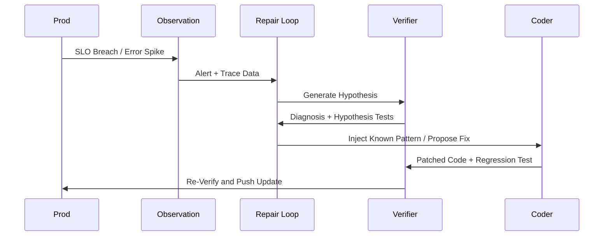
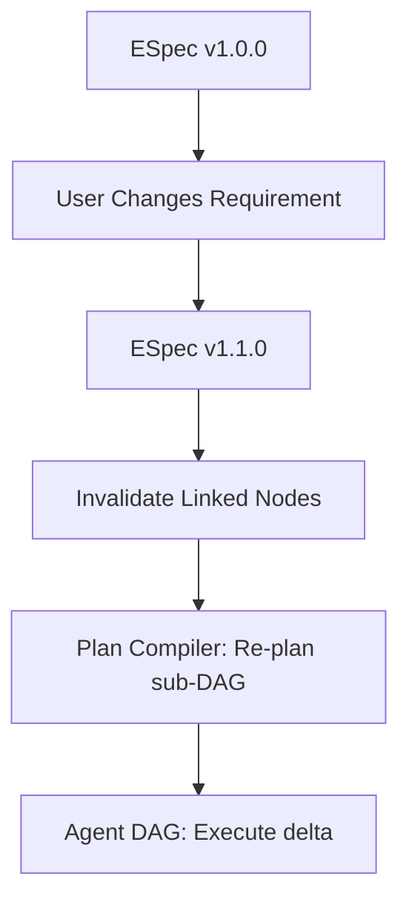

# G.O.D Machine v1.0 Architecture & Implementation Plan

**G.O.D Machine 2030 — The Sovereign Agentic Development OS**

*This document outlines the complete architecture, system design, API specifications, and implementation plan for G.O.D Machine v1.0.*

## Priority Directives
1. **Sovereignty**: Designed for fully air-gapped, zero-data-exfiltration environments.
2. **Security**: Multi-gate deterministic security pipelines assuming all code will reach production.
3. **Verification**: P99 evidence-based deterministic verification; average metrics are discarded.
4. **Intent Fidelity**: Hash-locked cryptographic traceability from compiled intent to deployed artifact.
5. **Execution Speed**: Compiled dependency DAGs with strict parallelism.
6. **Cost**: Granular capability routing favoring local tier-1/tier-2 execution.
7. **Usability**: Single-binary deployment (`god-machine init`) without external cloud dependencies.

---

## 1. System Architecture & Diagrams

### 1.1 Component Diagram

```mermaid
graph TD
    User([Human Authority]) --> |Intent| IC(Intent Compiler)
    IC --> |ISpec| SG(Specification Generator)
    SG --> |ESpec| PC(Plan Compiler)
    PC --> |Plan DAG| MR(Model Router)
    MR --> |Tasks| ADE(Agent DAG Executor)

    subgraph Agent Workforce
        ADE --> Arch[Architect]
        ADE --> Code[Coder]
        ADE --> Test[Tester]
        ADE --> Sec[Security]
        ADE --> Perf[Performer]
    end

    Code --> |Tool Requests| TF(Tool Fabric)
    Test --> |Tool Requests| TF

    subgraph Sandboxed Tools
        TF --> FileIO(File I/O Sandbox)
        TF --> Shell(Shell MicroVM)
        TF --> DB(Database Sandbox)
    end

    Agent Workforce --> |Code Artifacts| SGates(Security Gates)
    SGates --> |Verified Artifacts| VE(Verification Engine)
    VE --> |P99 Evidence| DP(Deployment Pipeline)

    DP --> |Deployed Service| OF(Observation Fabric)
    OF --> |Alerts/Metrics| RL(Repair Loop)
    RL --> |Diagnosis/Patch| PC
```

### 1.2 Data Flow Diagrams

**Intent → Production Lifecycle**


**Failure → Repair Loop**


**Spec Change → Cascade**


---

## 2. Threat Model

Designed assuming fully hostile environments, malicious dependencies, and compromised LLMs.

| Threat | Description | Mitigation (Deterministic) |
|---|---|---|
| **Prompt Injection** | User or external data injects commands causing agent malfunction. | Kernel restricts agent output to typed schemas. Agents do not execute actions; they request them. Tool Fabric sandbox rejects unsanctioned actions. |
| **Tool Abuse** | Compromised agent attempts to `rm -rf /` or leak data. | MicroVM (Firecracker) / gVisor isolation. Scoped File I/O. Zero external network egress by default. Kernel blocks out-of-scope tool requests. |
| **Data Exfiltration** | Agent attempts to send proprietary code to a third-party API. | Fully air-gapped system. Local models. No network tool access without explicit ESpec requirement. |
| **Supply Chain** | Agent pulls dependency with a zero-day or known CVE. | 5-gate pre-execution security pipeline (Snyk + OSV). Lockfile diffing against allowed organizational lists. |
| **Model Manipulation** | Model hallucinates verification success or overrides policies. | Verification is deterministic (P99 Engine), not LLM-based. Evidence is cryptographic (hashes, test results), never subjective. |
| **Verification Bypass** | Agent manually edits the `p99_latency` report to pass tests. | Evidence is collected externally by the Verification Engine (Tier 3 isolate) and signed. Agents lack write access to the evidence database. |

---

## 3. Component Specifications

### 3.1 Intent Compiler (IC) & ISpec
**Function:** Converts free-form human intent into a cryptographic contract.
* **Schema (ISpec):** YAML/JSON with `intent_id`, `goals` (with acceptance criteria), `non_goals`, `constraints`, `quality_thresholds`, `budget`, and `context`.
* **Validation Rules:** Must contain at least one measurable goal, zero contradiction in constraints, and explicitly bounded budget.
* **Compilation Algorithm:**
    1. Parse input.
    2. Extract structural properties.
    3. If ambiguity score > 0.1, halt and query human (max 5 questions).
    4. Compile YAML.
    5. Hash-lock output (SHA-256).

### 3.2 Executable Specification (ESpec)
**Function:** A versioned, machine-verifiable contract derived from the ISpec.
* **Schema (ESpec):** `spec_id`, `version`, `api` (OpenAPI 3.1), `data` (table definitions/RLS), `behavior` (test invariants), `performance` (P99 bounds), `security` (auth/encryption).
* **Versioning Rules:** Semantic versioning. Minor = additive, Major = breaking/schema changes. Any change triggers cascade invalidation of downstream DAG nodes.
* **Traceability Format:** Every downstream file/AST node must carry a header mapping to an ESpec section (e.g., `# Spec: SPEC-1023 §api.paths./v1/subscriptions`).

### 3.3 Plan Compiler & DAG
**Function:** Creates a deterministic, parallel execution plan.
* **Node Types:** `design`, `implement`, `test`, `audit`, `verify`, `deploy`.
* **Edge Types:** `depends_on`, `provides_data`, `blocks`.
* **Validation Rules:** DAG must be acyclic. Total estimated cost/time must be < ESpec budget. Every ESpec requirement must map to at least one terminal verification node.
* **Re-planning Protocol:** Max 3 retries per node. On failure, invalidate subgraph and query Tier 3 model for new approach. Halt and escalate to human after 3 failures.

### 3.4 Agent DAG Executor
**Function:** Fixed fleet of specialized, isolated agents.
* **Agent Roles:** Architect, Coder, Tester, Security, Performer, DevOps, DocWriter, Verifier.
* **Workspace Isolation:** One git worktree per agent. Merges are kernel-mediated AST-level merges.
* **Communication Protocol:** Agents exchange typed artifacts (e.g., `api_contract.yaml`, `test_failures.json`). No direct context sharing or free-text chat.
* **Failure Containment:** If node fails, tree prunes, replans isolated subtree without crashing sibling nodes.

### 3.5 Tool Fabric
**Function:** Mandatory sandbox for all physical actions.
* **Tool Types:** `file.read`, `file.write`, `shell.exec`, `db.query`, `net.request`.
* **Sandboxing:** MicroVM (Firecracker) for shell/network. FUSE overlays for file I/O.
* **Credential Injection:** Agents request actions using symbolic handles (e.g., `$STRIPE_KEY`). Tool Fabric resolves the secret from the local vault *inside* the execution sandbox. Agent never sees the literal secret.
* **Output Validation:** All tool stdout/stderr is schema-validated before returning to agent context.

### 3.6 Security Gates (SEK)
**Function:** Deterministic pipeline checking all code before it is allowed to execute.
* **5 Gates:**
    1. Static Analysis (Semgrep, CodeQL) - Threshold: 0 Critical, 0 High.
    2. Secrets Detection (TruffleHog) - Threshold: 0 findings.
    3. Dependency Audit (OSV) - Threshold: 0 known CVEs.
    4. Input Validation Check (AST rules) - Threshold: 100% of endpoints typed.
    5. Authorization Check (AST rules) - Threshold: 100% of endpoints protected.
* **Evidence Format:** Signed JSON artifact containing tool outputs, hashes of scanned files, and pass/fail booleans.

### 3.7 Verification Engine (PVE)
**Function:** Proves the application meets the ESpec at scale.
* **Evidence Format:** Immutable Parquet files containing raw metrics, assertions passed, and timestamps.
* **P99 Methodology:** Load generators sustain 10K concurrent connections (or ESpec defined) for 30 minutes. Average latency is ignored. If P99 > threshold, verification fails.
* **Spec Compliance Algorithm:** Deterministic AST/Schema diffing. Does OpenAPI generated from codebase == ESpec OpenAPI? If diff != 0, fail.

### 3.8 Deployment Pipeline
**Function:** Unsupervised progression to production.
* **Stages:** Build -> Stage -> Smoke Test -> Canary (5%) -> Monitor -> Promote (100%).
* **Gates:** PVE success, SEK success, User Approval (if AUTONOMOUS mode is not set).
* **Rollback Triggers:** P99 > threshold, Error Rate > 0.1%, CPU > 90% during canary.
* **Canary Metrics:** 15-minute rolling window tracking latency and HTTP 5xx codes against the baseline.

### 3.9 Repair Loop
**Function:** Automated diagnosis and healing of production issues.
* **Diagnosis Algorithm:** Correlate SLO breach with recent commits. Verifier generates hypothesis. Sub-DAG spawned to reproduce bug locally.
* **Pattern Library Format:** RDF/Knowledge graph storing `{Symptom, Root Cause, AST Patch}` (e.g., N+1 query -> apply eager loading).
* **Regression Test Generation:** Tester agent MUST write an invariant test that fails without the patch and passes with it. Mandatory addition to ESpec.

---

## 4. 24-Month Build Roadmap

### Phase 1: The Sovereign Kernel (Months 1-6)
* **Milestones:** Core Rust kernel, Intent Compiler, basic ESpec generation, local model integration (Ollama/llama.cpp), Firecracker sandbox integration.
* **Hardware Gate:** Operable on 32GB RAM (14B local models).
* **Language Support:** Python.

### Phase 2: Agent DAG & Security (Months 7-12)
* **Milestones:** 8-agent swarm implementation, strict workspace isolation (git worktrees), 5-Gate pre-execution security pipeline, Model Router fallback chains.
* **Hardware Gate:** Operable on 64GB RAM or 1x GPU (70B local models).
* **Language Support:** TypeScript, Rust.

### Phase 3: P99 Verification & Deployment (Months 13-18)
* **Milestones:** P99 Verification Engine, load testing synthesis, deterministic spec diffing, Canary deployment pipelines, IaC (Terraform) generation.
* **Hardware Gate:** Enterprise Multi-node capability for load generation.
* **Language Support:** Go, Java.

### Phase 4: Self-Healing & Mastery (Months 19-24)
* **Milestones:** Observation Fabric integration, sub-minute automated diagnosis, pattern library (knowledge graph), automated regression test enforcement.
* **Hardware Gate:** CXL memory pool / RDMA fabric (Enterprise scale).
* **Language Support:** C, C++, Kotlin, Swift.