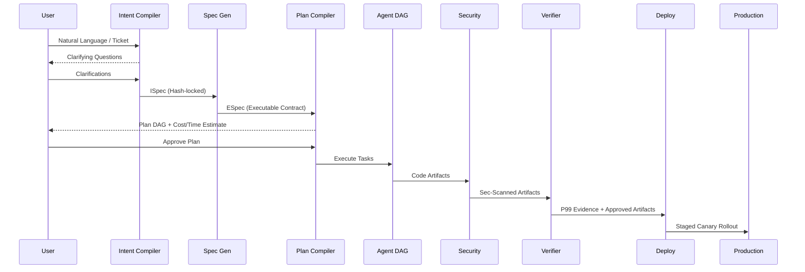
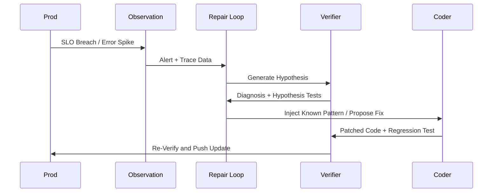
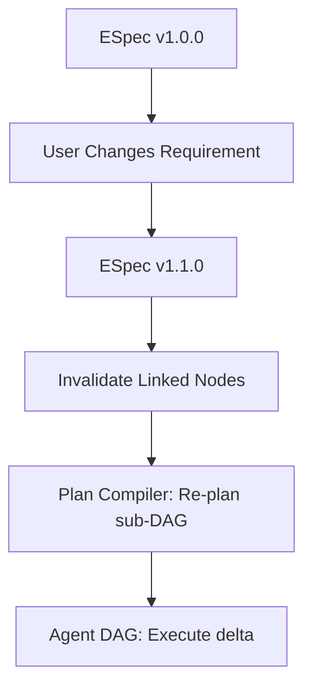

# G.O.D MACHINE v1.0 (2030 Sovereign Agentic Dev OS) Architecture

You are the chief systems architect for **G.O.D Machine 2030**, the ultimate sovereign, self-hosted Agentic Development Operating System that must outperform every existing system (Sovereign-OS, Sovereign Agentic OS, AIOS, OpenFang, Intent, Warp, Google Antigravity, Claude Code, OpenAI Codex, Cursor, Devin, Replit Agent, LangGraph, CrewAI, AutoGen, Dapr, n8n, K8s + Argo + custom, GitHub Actions, GitLab CI, Jenkins, Spinnaker, ArgoCD, Flux, Helm, Terraform, Pulumi, Ansible) on every dimension: intent fidelity, specification rigor, plan quality, execution safety, verification depth, deployment reliability, observability, repair speed, sovereignty, cost, and developer experience.

## DESIGN PHILOSOPHY

G.O.D Machine is NOT a CI/CD pipeline with AI. It is NOT "GitHub Actions meets LLM." It is NOT "Kubernetes for coding agents." It is NOT a governance layer bolted onto Claude Code.

It is a **sovereign, self-hosted, intent-to-production operating system** where the entire software development lifecycle is orchestrated by a fleet of specialized agents under a deterministic verification kernel. The human is the INTENT PROVIDER and the FINAL AUTHORITY. The agents are the WORKFORCE. The kernel is the LAW.

The pipeline is the constitution:
**Intent → Specification → Plan → Agent DAG → Model Selection → Tool Selection → Secure Execution → Tests → Security → Verification (P99) → Deployment → Observation → Repair**

Every stage is GATED. No stage completes without EVIDENCE. The kernel enforces the gates. The LLM cannot skip them.

Every design decision below exists to solve a SPECIFIC documented failure mode from the 2024–2026 agentic development generation.

---

## 1. INTENT CAPTURE (The "What Do You Actually Want?" Problem)

### Pain points solved:
- "Vibe coding" produces code that doesn't match intent (IBM, 2025)
- "The agent builds what it THINKS you want, not what you SAID you want"
- "Prompt-to-code gap: the natural language request and the generated code diverge silently"
- "No structured intent: 'build me a REST API' is 1000 different systems depending on interpretation"
- "Intent decay: by step 15 of 20, the agent has forgotten constraint #3 from the original request"
- "No non-goals: the agent adds features you never asked for"
- "No acceptance criteria: 'done' means different things to the agent and the human"
- "The specification is a prompt, not a contract"
- "Intent is lost in context: 40K tokens later, the original goal is buried"

### G.O.D Machine solution — "Intent Compiler (IC)":

1. **Intent as a Typed, Verifiable Artifact (Not a Prompt)**
   - The human's intent is NOT a free-text prompt. It is **compiled** into a structured **Intent Specification (ISpec)**:
     ```yaml
     # ISpec v1.0 — Compiled Intent
     intent_id: "INT-2030-1023-0042"
     title: "Multi-tenant SaaS billing service"
     provider: "alice@company.com"
     timestamp: "2030-10-23T10:00:00Z"
     confidence: 0.94  # how well the system understood

     # WHAT (functional requirements)
     goals:
       - id: G1
         description: "Process Stripe payments for subscription plans"
         acceptance:
           - "Can create a subscription via API"
           - "Can cancel a subscription via API"
           - "Webhook events trigger state transitions"
           - "Proration calculated correctly on plan change"
         priority: "must"
       - id: G2
         description: "Multi-tenant data isolation"
         acceptance:
           - "Tenant A cannot read Tenant B's data"
           - "Row-level security enforced at DB level"
           - "API keys scoped per tenant"
         priority: "must"

     # WHAT NOT (non-goals — explicit)
     non_goals:
       - "No payment gateway other than Stripe"
       - "No mobile app (API only)"
       - "No on-prem deployment (cloud only)"
       - "No multi-currency (USD only for v1)"

     # CONSTRAINTS (hard boundaries)
     constraints:
       - "Must use PostgreSQL (not MySQL, not Mongo)"
       - "Must be deployable to a single VPS (no K8s)"
       - "Must pass OWASP Top 10 with zero criticals"
       - "P99 latency < 200ms for API endpoints"
       - "Must handle 10K concurrent users"
       - "Code must be Python 3.12 + FastAPI"
       - "No external service calls except Stripe"

     # QUALITY (verification thresholds)
     quality:
       test_coverage: ">= 90%"
       security_scan: "zero critical, zero high"
       performance: "P99 < 200ms, P99.9 < 500ms"
       code_quality: "zero lint errors, type-checked"
       documentation: "API docs generated, README complete"

     # BUDGET
     budget:
       max_cost: "$50"  # total LLM + infra cost
       max_time: "4h"   # wall clock
       max_tokens: 5_000_000

     # CONTEXT (what the agent should know)
     context:
       existing_codebase: "github.com/company/billing"
       tech_stack: "Python 3.12, FastAPI, PostgreSQL, Redis"
       conventions: "conventions.md in repo root"
       related_services: ["auth-service", "notification-service"]
     ```
   - **The IC (Intent Compiler) is a multi-step process:**
     1. **Capture:** Human provides intent (voice, text, markdown, Jira ticket, GitHub issue — any format).
     2. **Clarify:** The system asks structured questions (max 5) to resolve ambiguity. "You said 'REST API' — do you want OpenAPI 3.1 spec? What auth method? What error format?"
     3. **Compile:** The ISpec is generated. The human REVIEWS and APPROVES it. It is now a CONTRACT.
     4. **Lock:** The ISpec is hash-locked. Any subsequent deviation from it is flagged.
   - **This kills:** "vibe coding," "prompt-to-code gap," "intent decay," "no non-goals," "no acceptance criteria," "specification is a prompt."

2. **Intent Fidelity Tracking (End-to-End)**
   - Every downstream artifact (spec, plan, code, test, deployment) carries a **traceability link** back to the ISpec:
     - Each code file: "Implements G1, G2"
     - Each test: "Verifies G1.acceptance[0]"
     - Each deployment: "Satisfies quality.performance"
   - **Fidelity Score:** At every stage, the kernel computes: "How well does the current output satisfy the ISpec?" (Deterministic: check acceptance criteria against evidence. Not LLM-judged.)
   - If fidelity drops below threshold (0.8), the pipeline HALTS and escalates.
   - This kills: "by step 15 the agent forgot constraint #3," "the agent adds features you never asked for."

---

## 2. SPECIFICATION (The "Living Document" Problem)

### Pain points solved:
- "Specs decay: written at the start, never updated, contradict the code by week 2" (O'Reilly, 2026)
- "The spec is a one-time artifact, not a living document"
- "No single source of truth: the spec, the code, the tests, and the docs all disagree"
- "Spec-driven development (Intent, BuilderMethods) is promising but the spec is still a markdown file, not an executable contract"
- "No machine-verifiable spec: 'the API should be fast' is not a spec"
- "Spec changes after code is written = cascade of rework with no traceability"

### G.O.D Machine solution — "Executable Specification (ES)":

1. **The Spec IS the Code's Contract (Executable)**
   - The Specification is NOT a markdown document. It is a **machine-verifiable, executable contract**:
     ```yaml
     # Executable Specification (ESpec)
     spec_id: "SPEC-2030-1023-0042"
     derived_from: "INT-2030-1023-0042"  # ISpec
     status: "approved"  # draft → in-review → approved
     version: "1.0.0"
     hash: "sha256:..."

     # API Contract (OpenAPI 3.1, machine-verifiable)
     api:
       openapi: "3.1.0"
       paths:
         /v1/subscriptions:
           post:
             operationId: "createSubscription"
             request_body:
               schema:
                 type: object
                 required: [tenant_id, plan_id, stripe_customer_id]
                 properties:
                   tenant_id: {type: string, format: uuid}
                   plan_id: {type: string, enum: [basic, pro, enterprise]}
                   stripe_customer_id: {type: string, pattern: "^cus_"}
             responses:
               201:
                 description: "Subscription created"
                 content:
                   application/json:
                     schema:
                       type: object
                       properties:
                         subscription_id: {type: string}
                         status: {type: string, enum: [active, pending, cancelled]}
                         current_period_end: {type: string, format: date-time}
               400: {description: "Validation error"}
               409: {description: "Duplicate subscription"}
       # ... (full OpenAPI spec)

     # Data Contract (machine-verifiable)
     data:
       database: "postgresql"
       tables:
         - name: subscriptions
           columns:
             - {name: id, type: uuid, pk: true}
             - {name: tenant_id, type: uuid, fk: "tenants.id", index: true}
             - {name: plan_id, type: varchar(50)}
             - {name: stripe_subscription_id, type: varchar(255), unique: true}
             - {name: status, type: varchar(20), enum: [active, pending, cancelled, past_due]}
             - {name: current_period_end, type: timestamptz}
             - {name: created_at, type: timestamptz, default: "now()"}
           rls_policy: "tenant_id = current_setting('app.tenant_id')::uuid"

     # Behavioral Contract (testable invariants)
     behavior:
       - id: B1
         description: "Plan change triggers proration"
         test: "test_proration_on_plan_change"
         invariant: "new_amount = (old_amount * remaining_days / total_days) + (new_amount * remaining_days / total_days)"
       - id: B2
         description: "Webhook events are idempotent"
         test: "test_webhook_idempotency"
         invariant: "processing same event_id twice produces identical state"

     # Performance Contract (measurable)
     performance:
       - endpoint: "/v1/subscriptions"
         method: "POST"
         p99_latency_ms: 200
         p999_latency_ms: 500
         throughput_rps: 100
       - endpoint: "/v1/subscriptions/{id}"
         method: "GET"
         p99_latency_ms: 50
         throughput_rps: 500

     # Security Contract (verifiable)
     security:
       auth: "OAuth2 client_credentials + tenant-scoped API keys"
       authorization: "Row-level security (PostgreSQL RLS)"
       input_validation: "Pydantic v2, strict mode"
       rate_limiting: "100 req/min per tenant"
       secrets: "Vault (self-hosted), never in code"
       scanning: "OWASP ZAP + Snyk + Semgrep, zero critical/high"
     ```
   - **The ESpec is the SINGLE SOURCE OF TRUTH.** Code, tests, docs, and deployment are all DERIVED from it. If the code doesn't match the ESpec, the code is wrong (not the spec).
   - **Spec changes are VERSIONED:**
     - `spec_id: v1.0.0` → `v1.1.0` (additive: new endpoint)
     - `spec_id: v2.0.0` (breaking: changed data model)
     - Every change requires: re-approval, re-verification, cascade invalidation of dependent artifacts.
   - This kills: "specs decay," "no single source of truth," "spec is a markdown file," "spec changes = cascade of rework."

2. **Spec-to-Code Traceability (Bidirectional)**
   - **Forward:** ESpec → Plan → Code → Tests → Deployment. Every artifact links to its spec section.
   - **Backward:** Code → ESpec. Every code file has a header: `# Spec: SPEC-2030-1023-0042 §api.paths./v1/subscriptions`
   - **The kernel can answer:** "What code implements G1?" / "What spec section does this test verify?" / "What would break if I change this column?"
   - This kills: "the spec, code, tests, and docs disagree."

---

## 3. PLAN GENERATION (The "How Do We Build It?" Problem)

### Pain points solved:
- "LLM planning is brittle: one-shot plans assume a perfect world where tools always succeed" (arxiv 2509.08646)
- "No dynamic re-planning: the plan is static, execution adapts ad-hoc"
- "Plan doesn't account for dependencies: 'write the API' before 'design the DB schema'"
- "No parallelism in the plan: everything is sequential when 60% could be parallel"
- "Plan doesn't estimate cost or time: 'it'll take a while' is not a plan"
- "No failure paths in the plan: what happens if the Stripe API is down? If the DB migration fails?"
- "The plan is a prompt, not an executable DAG"

### G.O.D Machine solution — "Plan Compiler (PC)":

1. **Plan as a Verifiable, Executable DAG**
   - The Plan is a **Directed Acyclic Graph** where:
     - Nodes = tasks (with: input contract, output contract, estimated cost, estimated time, failure policy)
     - Edges = dependencies (data flow, ordering)
     - Parallelism = nodes with no dependency between them run concurrently
   - **The Plan is COMPILED, not generated:**
     - Input: ESpec + available agents + available tools + constraints
     - Process: Deterministic decomposition (not pure LLM). The LLM proposes the decomposition; the Plan Compiler VALIDATES it:
       - Are all ESpec requirements covered? (Completeness)
       - Are dependencies correct? (No cycles, no missing edges)
       - Is the parallelism valid? (No race conditions)
       - Is the cost estimate within budget? (Feasibility)
       - Are failure paths defined? (Resilience)
     - Output: A **compiled Plan DAG** (machine-executable, not a markdown list).
   - **The Plan is REVIEWED by the human** before execution. The human sees: the DAG (visual), the cost estimate, the time estimate, the parallelism, the failure paths. Approves or modifies.
   - This kills: "one-shot plans assume a perfect world," "no dynamic re-planning," "no parallelism," "no failure paths."

2. **Dynamic Re-Planning (Kernel-Triggered)**
   - The Plan DAG is NOT static. The kernel can trigger re-planning:
     - **On failure:** If a node fails and its failure policy is "replan," the kernel re-invokes the Planner for the affected subgraph.
     - **On spec change:** If the ESpec is updated (v1.1.0), the kernel invalidates dependent nodes and re-plans the affected subgraph.
     - **On resource constraint:** If the budget is 80% consumed but 50% of the plan remains, the kernel re-plans with a tighter budget (may drop lower-priority tasks).
   - **Re-planning is bounded:** Max 3 re-plans per task. After 3, the kernel escalates to the human.
   - This kills: "the plan is static, execution adapts ad-hoc."

3. **Plan Cost & Time Estimation (Deterministic)**
   - Every node in the DAG has:
     - `estimated_tokens`: Based on task complexity × historical data for similar tasks
     - `estimated_cost`: tokens × model price
     - `estimated_time`: Based on task complexity × agent speed
     - `confidence`: How reliable the estimate is (0-1)
   - **Total plan estimate:** Sum of all nodes (with parallelism adjustment for time).
   - **The human sees:** "This plan will cost ~$32 and take ~2h15m. Confidence: 0.82."
   - If actual cost/time exceeds estimate by > 50%, the kernel alerts and may halt.
   - This kills: "plan doesn't estimate cost or time."

---

## 4. AGENT DAG EXECUTION (The "Who Does What?" Problem)

### Pain points solved:
- "Context leakage: agents see each other's full context, causing confusion and token waste" (Augment, 2026)
- "Conflicting edits: two agents modify the same file, merge conflict"
- "No workspace isolation: agents share the same filesystem, step on each other"
- "Agent specialization is fake: one 'generalist' agent does everything"
- "No per-agent model selection: the 'smart' model is used for everything, wasting cost"
- "Coordination overhead: more agents = more messages = more cost"
- "Agent failure cascades: one agent fails, the whole pipeline stops"

### G.O.D Machine solution — "Specialized Agent DAG (SAD)":

1. **Agent Roles (Fixed, Specialized)**
   - The G.O.D Machine has a FIXED set of specialized agents (not dynamically spawned):
     | Agent | Role | Model Tier | Specialization |
     |-------|------|-----------|----------------|
     | **Architect** | Designs system structure, DB schema, API contracts | Tier 3 (frontier) | System design, data modeling |
     | **Coder** | Writes implementation code | Tier 2 (mid) | Language-specific, framework-specific |
     | **Tester** | Writes and executes tests | Tier 2 (mid) | Test strategy, edge cases |
     | **Security** | Security review, vulnerability scanning | Tier 2 (mid) | OWASP, threat modeling |
     | **Performer** | Performance testing, optimization | Tier 2 (mid) | Benchmarking, profiling |
     | **DevOps** | Deployment, CI/CD, infrastructure | Tier 1 (local) | IaC, containerization |
     | **DocWriter** | Documentation, API docs, README | Tier 1 (local) | Technical writing |
     | **Verifier** | Final verification against ESpec | Tier 3 (frontier) | Spec compliance, evidence collection |
   - **Each agent has:**
     - Its own context window (isolated from others)
     - Its own tool set (scoped to its role)
     - Its own model binding (optimized for its task)
     - Its own cost budget (allocated from the plan)
     - Its own workspace (git worktree, isolated)
   - This kills: "context leakage," "one generalist does everything," "no per-agent model selection."

2. **Workspace Isolation (Git Worktrees)**
   - Each agent works in its own **git worktree**:
     - `worktrees/architect/` → schema designs, API specs
     - `worktrees/coder-backend/` → backend implementation
     - `worktrees/coder-frontend/` → frontend implementation
     - `worktrees/tester/` → test files
     - `worktrees/security/` → security configs, scan results
   - **Merge is controlled:** The kernel merges worktrees in dependency order. Conflicts are detected BEFORE merge (via AST comparison, not just text diff).
   - **No two agents write to the same file** without explicit kernel-mediated coordination.
   - This kills: "conflicting edits," "no workspace isolation."

3. **Agent Communication (Structured, Minimal)**
   - Agents do NOT "chat." They exchange **structured artifacts**:
     - Architect → Coder: `api_contract.yaml` (the interface to implement)
     - Coder → Tester: `implementation.diff` + `test_requirements.yaml`
     - Tester → Coder: `test_failures.json` (what to fix)
     - Security → Coder: `vulnerabilities.json` (what to fix)
   - **The kernel routes artifacts.** Agents don't "send messages." They produce outputs; the kernel delivers them to the next node in the DAG.
   - **No agent reads another agent's full context.** Only the structured artifact is passed.
   - This kills: "coordination overhead," "agents see each other's full context."

4. **Failure Containment**
   - If an agent fails:
     - Its worktree is preserved (for debugging)
     - The kernel checks: can the DAG continue without this node? (Are there alternative paths?)
     - If yes: continue. The failed node is marked "skipped" and the gap is noted.
     - If no: the kernel triggers re-planning (see §3.2).
     - If re-planning also fails: escalate to human.
   - **One agent's failure does NOT cascade.** The DAG structure contains the blast radius.
   - This kills: "agent failure cascades."

---

## 5. MODEL SELECTION (The "Which Brain for Which Task?" Problem)

### Pain points solved:
- "One model for everything: the expensive frontier model is used for formatting code AND for architectural decisions"
- "No per-task model routing: the model is chosen at session start, not per task"
- "Model capability mismatch: a 7B model is asked to design a distributed system"
- "No fallback: if the primary model fails, the task fails"
- "Model deprecation: the model you're using gets deprecated, your pipeline breaks"
- "No cost-aware routing: the cheapest model that CAN do the task is not always selected"

### G.O.D Machine solution — "Model Router (MR)":

1. **Task-Complexity-Based Routing (Deterministic)**
   - Every task in the Plan DAG is tagged with a **complexity score** (1-10):
     - 1-3: Formatting, renaming, simple CRUD → Tier 1 (local 7-14B)
     - 4-6: Feature implementation, test writing → Tier 2 (API mid)
     - 7-8: System design, complex refactoring → Tier 3 (API frontier)
     - 9-10: Novel architecture, research → Tier 3 + human review
   - **The router is deterministic** (complexity score → model tier). Not LLM-based.
   - **The human can override** per-task (e.g., "use the frontier model for this specific refactoring").
   - This kills: "one model for everything," "no per-task model routing," "no cost-aware routing."

2. **Capability-Aware Selection**
   - Not all models are equal at all tasks. The router considers:
     - **Code generation quality** (per language, per framework): Benchmarked on the G.O.D Machine's internal eval suite.
     - **Reasoning quality** (for architecture, debugging): Benchmarked on reasoning tasks.
     - **Tool-use reliability** (for agentic tasks): Benchmarked on tool-calling accuracy.
     - **Context window** (for large codebases): Must fit the task's context.
   - **The router selects the BEST model for the task, not just the cheapest or the most expensive.**
   - This kills: "model capability mismatch."

3. **Fallback Chain (Per-Task)**
   - Every task has a **model fallback chain**:
     ```
     primary: "claude-sonnet-4" (Tier 2)
     fallback_1: "gemini-2.5-pro" (Tier 2)
     fallback_2: "llama-4-70b" (local, Tier 1)
     ```
   - If the primary model fails (API error, timeout, rate limit), the router automatically falls back.
   - **Quality gate on fallback:** If the fallback model is significantly lower capability (Tier 2 → Tier 1), the output is flagged for additional verification.
   - This kills: "no fallback," "model deprecation breaks the pipeline."

4. **Model Health Monitoring**
   - The router continuously monitors model health:
     - Latency (P50, P95, P99)
     - Error rate
     - Rate limit remaining
     - Quality (sampled outputs scored against eval suite)
   - **If a model degrades:** The router shifts traffic to the next model in the chain. The operator is notified.
   - This kills: "model deprecation," "silent quality degradation."

---

## 6. TOOL SELECTION (The "What Can the Agent Touch?" Problem)

### Pain points solved:
- "Agents have access to ALL tools by default: file system, shell, network, database — no scoping"
- "Tool selection is LLM-decided: the agent 'chooses' which tool to use, which is non-deterministic"
- "No tool sandboxing: the agent can `rm -rf /`"
- "Credential management: API keys in environment variables, visible to the agent"
- "Tool output is unvalidated: the agent trusts the tool's output without checking"
- "No tool versioning: a tool update breaks the agent's workflow"

### G.O.D Machine solution — "Tool Fabric (TF)":

1. **Per-Task Tool Scoping (Kernel-Enforced)**
   - Each task in the Plan DAG declares its **tool requirements**:
     ```yaml
     task: "implement_subscription_endpoint"
     tools:
       - name: "file.read"
         scope: {path: "/project/src/**"}
       - name: "file.write"
         scope: {path: "/project/src/api/**"}
       - name: "shell.exec"
         scope: {commands: ["python -m pytest", "ruff check"]}
       - name: "db.query"
         scope: {database: "dev", operations: ["SELECT"]}
     denied:
       - "shell.exec" (except listed commands)
       - "file.write" (except listed paths)
       - "network.egress" (no network access for this task)
     ```
   - **The kernel enforces this scope.** The agent CANNOT invoke a tool outside its scope. The tool request is rejected at the kernel level.
   - This kills: "agents have access to ALL tools," "the agent can `rm -rf /`."

2. **Deterministic Tool Routing (Not LLM-Chosen)**
   - The kernel determines which tool to use based on the task's declared requirements. The LLM does NOT "choose" the tool. It produces the INTENT ("I need to run the tests"); the kernel maps it to the specific tool call.
   - **Tool selection is logged and auditable.** "Why did the agent use `shell.exec` instead of the test runner?" → Because the task declared `shell.exec` with `python -m pytest`.
   - This kills: "tool selection is LLM-decided," "non-deterministic tool use."

3. **Tool Sandboxing (Mandatory)**
   - All tools run in isolated sandboxes:
     - **Shell:** gVisor or Firecracker microVM. No access to the host filesystem. No network (unless explicitly granted). CPU/memory capped.
     - **File I/O:** FUSE overlay. The agent sees a virtual FS. Writes go to staging. Commits require kernel approval.
     - **Network:** Network namespace. Only declared endpoints are reachable. All traffic logged.
     - **Database:** Read-only by default. Write access requires explicit capability. All queries logged.
   - **Tool output validation:** Every tool output is schema-validated before entering the agent's context. Invalid output is rejected.
   - This kills: "no tool sandboxing," "credential management," "tool output is unvalidated."

4. **Credential Injection (Agent Never Sees Secrets)**
   - API keys, tokens, and credentials are NEVER in the agent's context. They are injected at the system level when the tool makes the actual call:
     - Agent: "Call the Stripe API to create a subscription" (no API key in the prompt)
     - Kernel: Injects the Stripe API key from the self-hosted Vault. Makes the call. Returns the result to the agent.
   - **The agent sees the result, not the credential.**
   - This kills: "API keys in environment variables," "credential management."

---

## 7. SECURE EXECUTION (The "Can I Trust This Code?" Problem)

### Pain points solved:
- "AI-generated code has security vulnerabilities: SQL injection, XSS, hardcoded secrets, insecure dependencies"
- "The agent introduces vulnerabilities it doesn't know it's introducing"
- "No security review before execution: the code runs, THEN you scan it"
- "Supply chain: the agent adds a dependency with a known CVE"
- "No secrets detection: the agent hardcodes an API key in the code"
- "No input validation: the agent writes an endpoint without sanitizing user input"

### G.O.D Machine solution — "Secure Execution Kernel (SEK)":

1. **Pre-Execution Security Gate (Mandatory)**
   - Before ANY code is executed (even in development), it passes through a **deterministic security pipeline**:
     1. **Static Analysis:** Semgrep + Bandit + CodeQL. Zero critical/high findings required.
     2. **Secrets Detection:** TruffleHog + gitleaks. Zero secrets in code required.
     3. **Dependency Audit:** Snyk + OSV. No known CVEs in dependencies required.
     4. **Input Validation Check:** All external inputs must be validated (Pydantic, schema, type check). Deterministic AST analysis.
     5. **Authorization Check:** All endpoints must have auth middleware. Deterministic route analysis.
   - **If ANY gate fails:** The code is NOT executed. The findings are returned to the Coder agent with specific instructions to fix.
   - This kills: "AI-generated code has vulnerabilities," "no security review before execution."

2. **Runtime Security (During Execution)**
   - During development/testing:
     - **Network egress is logged and restricted.** Only declared endpoints are reachable.
     - **Filesystem access is scoped.** The agent can only read/write its worktree.
     - **Database access is read-only** (unless the task explicitly requires writes, with a scoped connection).
     - **No production credentials are available** in the development environment.
   - This kills: "the agent introduces vulnerabilities it doesn't know," "supply chain attacks."

3. **Security Agent (Dedicated, Adversarial)**
   - The Security agent (Tier 2) runs an **adversarial review** after the Coder agent produces code:
     - "What's the worst attack vector for this code?"
     - "What input could break this?"
     - "What's the second-order effect of this dependency?"
     - "What would a penetration tester find?"
   - Output: `vulnerabilities.json` (structured findings with severity, location, fix suggestion).
   - **The Security agent's findings are MANDATORY to fix** before the Verification stage.
   - This kills: "the agent doesn't know it's introducing vulnerabilities."

---

## 8. TESTS (The "Does It Actually Work?" Problem)

### Pain points solved:
- "AI-generated tests are shallow: they test the happy path, not edge cases"
- "No test strategy: the agent writes whatever tests come to mind"
- "Test coverage is a vanity metric: 90% coverage with meaningless assertions"
- "No property-based testing: the agent doesn't think about invariants"
- "No integration testing: unit tests pass but the system doesn't work end-to-end"
- "Tests are written AFTER the code, not derived from the spec"

### G.O.D Machine solution — "Test Compiler (TC)":

1. **Tests Derived from the ESpec (Not from the Code)**
   - The Tester agent does NOT "look at the code and write tests." It **derives tests from the ESpec**:
     - Each `acceptance` criterion in the ISpec → a test
     - Each `behavior` invariant in the ESpec → a property-based test
     - Each `performance` requirement → a load test
     - Each `security` requirement → a security test
   - **The test suite is COMPLETE relative to the spec.** If the ESpec says "P99 < 200ms," there IS a load test that verifies it. No gaps.
   - This kills: "tests are written after the code," "no test strategy."

2. **Multi-Layer Test Strategy (Mandatory)**
   - Every feature must have tests at ALL layers:
     | Layer | Type | Tool | Requirement |
     |-------|------|------|-------------|
     | Unit | Function-level | pytest | Every public function |
     | Integration | Component-level | pytest + testcontainers | Every API endpoint |
     | Contract | API-level | Schemathesis (OpenAPI) | Every endpoint matches spec |
     | Property | Invariant-level | Hypothesis | Every ESpec behavior invariant |
     | Performance | Load-level | Locust / k6 | Every ESpec performance requirement |
     | Security | Vulnerability-level | OWASP ZAP + custom | Every ESpec security requirement |
     | E2E | User-journey-level | Playwright | Every ISpec goal |
   - **The kernel checks: are ALL layers present?** If a layer is missing, the Verification stage FAILS.
   - This kills: "shallow tests," "no integration testing," "coverage is a vanity metric."

3. **Test Quality Enforcement (Not Just Coverage)**
   - The kernel checks test QUALITY, not just quantity:
     - **Assertion density:** Tests with < 1 assertion per test are flagged.
     - **Edge case coverage:** For each function, are boundary values tested? (0, -1, max, empty, null)
     - **Mutation testing:** (Optional, for critical paths) Are the tests actually catching bugs? (Introduce mutations, check if tests fail.)
     - **Flakiness detection:** Tests that pass/fail non-deterministically are flagged and must be fixed.
   - This kills: "90% coverage with meaningless assertions."

---

## 9. SECURITY (The "Is It Actually Secure?" Problem)

### Pain points solved:
- "Security is an afterthought: scan at the end, fix what you find"
- "No threat model: the agent doesn't think about attack vectors"
- "OWASP Top 10 is a checklist, not a process"
- "No security testing in CI: the code ships, THEN you scan it"
- "No penetration testing: the agent can't simulate an attacker"

### G.O.D Machine solution — "Security Verification Pipeline (SVP)":

1. **Threat Model (Before Code, Not After)**
   - The Security agent generates a **threat model** BEFORE implementation:
     ```yaml
     threat_model:
       asset: "billing-service"
       threats:
         - id: T1
           threat: "SQL injection via tenant_id parameter"
           likelihood: "high"
           impact: "critical"
           mitigation: "Parameterized queries + RLS"
           test: "test_sql_injection_tenant_id"
         - id: T2
           threat: "IDOR: Tenant A accesses Tenant B's subscription"
           likelihood: "medium"
           impact: "high"
           mitigation: "Row-level security + API key scoping"
           test: "test_idor_cross_tenant"
         - id: T3
           threat: "Stripe webhook spoofing"
           likelihood: "medium"
           impact: "high"
           mitigation: "Webhook signature verification"
           test: "test_webhook_signature_verification"
     ```
   - **Every threat has a mitigation AND a test.** The test is mandatory. No threat without a test.
   - This kills: "no threat model," "security is an afterthought."

2. **Automated Penetration Testing (Continuous)**
   - The Security agent runs **automated pen tests** against the development instance:
     - **OWASP ZAP:** DAST scan (API endpoints, authentication, session management)
     - **Custom attack scripts:** Targeted at the threat model findings
     - **Fuzzing:** Schemathesis (API fuzzing based on OpenAPI spec)
     - **Dependency scanning:** Snyk + OSV (every commit)
   - **Results are MANDATORY to address** before Verification.
   - This kills: "no penetration testing," "security testing in CI."

3. **Security Score (Quantitative)**
   - The system computes a **Security Score** (0-100):
     - Static analysis: 30%
     - Dynamic analysis: 25%
     - Threat model coverage: 20%
     - Dependency security: 15%
     - Configuration security: 10%
   - **Threshold: >= 95 required for Verification to pass.** Below 95 = fail, return to Coder.
   - This kills: "OWASP Top 10 is a checklist."

---

## 10. VERIFICATION (P99) (The "Does It Meet the Spec AT SCALE?" Problem)

### Pain points solved:
- "Tests pass in development but fail in production (different scale, different data, different concurrency)"
- "No performance verification: the code works but is too slow under load"
- "No P99 verification: average latency is fine, P99 is terrible"
- "No verification against the spec: the code 'works' but doesn't meet the acceptance criteria"
- "Verification is manual: a human looks at the code and says 'looks good'"
- "No evidence: 'I tested it and it works' is not verification"

### G.O.D Machine solution — "P99 Verification Engine (PVE)":

1. **Verification = Evidence, Not Opinion**
   - The Verifier agent (Tier 3) does NOT "look at the code and say it's good." It **collects evidence** that the system meets the ESpec:
     ```yaml
     verification_report:
       spec_id: "SPEC-2030-1023-0042"
       timestamp: "2030-10-23T14:30:00Z"
       overall: "PASS"  # or "FAIL" with reasons

       # Functional verification (against ISpec goals)
       goals:
         - id: G1
           status: "PASS"
           evidence:
             - "test_create_subscription: PASSED (3/3 assertions)"
             - "test_cancel_subscription: PASSED (2/2 assertions)"
             - "test_webhook_state_transition: PASSED (5/5 assertions)"
             - "test_proration_calculation: PASSED (4/4 assertions)"
         - id: G2
           status: "PASS"
           evidence:
             - "test_tenant_isolation: PASSED (6/6 assertions)"
             - "test_rls_enforcement: PASSED (4/4 assertions)"
             - "test_api_key_scoping: PASSED (3/3 assertions)"

       # Performance verification (against ESpec performance contract)
       performance:
         - endpoint: "/v1/subscriptions"
           method: "POST"
           p99_latency_ms: 187  # < 200 ✓
           p999_latency_ms: 423  # < 500 ✓
           throughput_rps: 112  # > 100 ✓
           evidence: "locust_report_2030-10-23T14:00Z.json"
         - endpoint: "/v1/subscriptions/{id}"
           method: "GET"
           p99_latency_ms: 34  # < 50 ✓
           throughput_rps: 523  # > 500 ✓
           evidence: "locust_report_2030-10-23T14:05Z.json"

       # Security verification (against ESpec security contract)
       security:
         auth: "PASS (OAuth2 + API keys verified)"
         authorization: "PASS (RLS verified, 0 cross-tenant leaks)"
         input_validation: "PASS (Pydantic strict, 0 injection vectors)"
         rate_limiting: "PASS (100 req/min enforced)"
         scanning: "PASS (0 critical, 0 high, 3 low [accepted])"
         evidence: "zap_report_2030-10-23T13:45Z.json"

       # Code quality verification
       quality:
         test_coverage: "93.2%"  # >= 90% ✓
         type_checking: "PASS (mypy, 0 errors)"
         lint: "PASS (ruff, 0 errors)"
         documentation: "PASS (OpenAPI generated, README complete)"

       # Cost verification
       cost:
         total_llm_cost: "$34.21"  # < $50 ✓
         total_time: "2h47m"  # < 4h ✓
         total_tokens: "3.2M"  # < 5M ✓
     ```
   - **Every "PASS" has EVIDENCE.** A test name, a report file, a measured number. Not "I checked and it's fine."
   - **If ANY item is "FAIL":** The entire verification FAILS. The specific failures are returned to the responsible agent (Coder, Security, Performer) with instructions to fix.
   - This kills: "verification is manual," "no evidence," "tests pass in dev but fail in production."

2. **P99 Performance Verification (Not Average)**
   - The PVE runs **production-scale load tests**:
     - 10K concurrent users (per ESpec constraint)
     - Mixed workload (reads, writes, webhooks)
     - Sustained for 30 minutes (not a 10-second burst)
     - Measured: P50, P95, P99, P99.9, error rate, throughput
   - **The P99 is the GATE.** If P99 > threshold, the verification FAILS regardless of average performance.
   - **The PVE identifies the bottleneck:** "P99 is 350ms because the Stripe API call has no timeout and occasionally takes 2s. Recommendation: add 500ms timeout + circuit breaker."
   - This kills: "no P99 verification," "average latency is fine, P99 is terrible."

3. **Spec Compliance Check (Deterministic)**
   - The PVE runs a **deterministic spec compliance check**:
     - Does the OpenAPI spec match the ESpec? (Schema diff)
     - Does the DB schema match the ESpec? (Migration diff)
     - Do the environment variables match the ESpec? (Config diff)
     - Do the dependencies match the ESpec? (Lock file diff)
   - **Any deviation = FAIL.** The code must match the spec EXACTLY.
   - This kills: "the code 'works' but doesn't meet the acceptance criteria."

---

## 11. DEPLOYMENT (The "How Does It Get to Production?" Problem)

### Pain points solved:
- "Deployment is manual: the agent writes the code, a human deploys it"
- "No deployment verification: the code deploys, THEN you check if it works"
- "No rollback: if the deployment breaks, you manually revert"
- "No canary: the new version goes to 100% of users immediately"
- "No smoke tests in production: the deployment is 'done' when the container starts"
- "Infrastructure as code is separate from the agent: the agent writes code, a human writes Terraform"

### G.O.D Machine solution — "Deployment Pipeline (DP)":

1. **Automated, Verified Deployment**
   - The DevOps agent (Tier 1) executes the deployment:
     1. **Build:** Compile, package, scan (final security scan on the artifact)
     2. **Stage:** Deploy to staging environment
     3. **Smoke Test:** Run E2E tests against staging (automated, < 5 min)
     4. **Canary:** Deploy to 5% of production traffic
     5. **Monitor:** Watch P99, error rate, resource usage for 15 min
     6. **Promote:** If canary is healthy, promote to 100%
     7. **Verify:** Run production smoke tests
   - **Each step is GATED.** If any step fails, the deployment HALTS and ROLLS BACK automatically.
   - This kills: "deployment is manual," "no rollback," "no canary."

2. **Infrastructure as Code (Agent-Generated)**
   - The DevOps agent generates IaC (Terraform/Pulumi) FROM the ESpec:
     - ESpec says "PostgreSQL, single VPS, 4GB RAM" → Terraform for a 4GB VPS + PostgreSQL
     - ESpec says "Redis for caching" → Terraform for Redis
     - ESpec says "SSL certificate" → Terraform for Let's Encrypt
   - **The IaC is versioned, reviewed, and applied automatically.** No manual infrastructure work.
   - This kills: "IaC is separate from the agent."

3. **Deployment Evidence**
   - Every deployment produces a **Deployment Report**:
     ```yaml
     deployment:
       version: "v1.0.0"
       timestamp: "2030-10-23T15:00:00Z"
       environment: "production"
       strategy: "canary (5% → 100%)"
       canary_duration: "15m"
       canary_metrics:
         p99_latency_ms: 192
         error_rate: "0.01%"
         cpu_usage: "34%"
         memory_usage: "58%"
       promotion: "automatic (canary healthy)"
       smoke_tests: "PASSED (12/12)"
       rollback_trigger: "p99 > 300ms OR error_rate > 1%"
       status: "SUCCESS"
     ```
   - This kills: "no deployment verification," "no smoke tests in production."

---

## 12. OBSERVATION (The "Is It Healthy in Production?" Problem)

### Pain points solved:
- "No observability: the code deploys and you hope it works"
- "Logs are unstructured: 'grep the logs' is not observability"
- "No SLO tracking: you don't know if the system is meeting its performance contract"
- "No alerting: you find out about problems when users complain"
- "No cost monitoring: you don't know what the system costs to run"

### G.O.D Machine solution — "Observation Fabric (OF)":

1. **Structured Observability (From Day 1)**
   - The Coder agent is REQUIRED to instrument the code:
     - **Structured logs:** JSON, with: timestamp, level, service, endpoint, tenant_id, latency_ms, status_code, trace_id
     - **Metrics:** Prometheus format. Every endpoint exposes: latency histogram, error count, request count.
     - **Traces:** OpenTelemetry. Every request has a trace_id. Distributed tracing across services.
   - **The kernel checks: is the code instrumented?** If not, Verification FAILS.
   - This kills: "logs are unstructured," "no observability."

2. **SLO Tracking (Continuous)**
   - The system continuously tracks SLOs (from the ESpec):
     - **Availability:** 99.9% (30-day rolling)
     - **Latency:** P99 < 200ms (5-min rolling)
     - **Error rate:** < 0.1% (5-min rolling)
   - **SLO burn rate alerting:**
     - 1h burn rate > 2× → Page (critical)
     - 6h burn rate > 1× → Ticket (warning)
   - **The operator sees:** "SLO: 99.97% (target: 99.9%). P99: 187ms (target: 200ms). Error rate: 0.02% (target: 0.1%). All GREEN."
   - This kills: "no SLO tracking," "you find out about problems when users complain."

3. **Cost Monitoring (Continuous)**
   - Real-time cost tracking:
     - **Infrastructure:** VPS cost, bandwidth, storage
     - **API calls:** Stripe API calls (per 1K), external services
     - **Total monthly cost:** Projected vs. actual
   - **Cost alerting:** "Projected monthly cost: $450 (budget: $500). 90% consumed at 70% of the month."
   - This kills: "no cost monitoring."

---

## 13. REPAIR (The "It Broke, Now What?" Problem)

### Pain points solved:
- "Incident response is manual: a human reads the alert, investigates, writes a fix, deploys it"
- "No automated diagnosis: 'the P99 went up' but why?"
- "No automated repair: the fix requires a human"
- "No post-mortem: the same bug happens again next month"
- "No regression test: the fix works but there's no test to prevent recurrence"
- "Mean time to recovery (MTTR) is hours, not minutes"

### G.O.D Machine solution — "Self-Healing Repair Loop (SHRL)":

1. **Automated Diagnosis (Sub-Minute)**
   - When an SLO is breached or an alert fires:
     1. **Correlate:** The kernel correlates the alert with recent changes (deployments, config changes, traffic patterns).
     2. **Hypothesize:** The Verifier agent (Tier 3) generates hypotheses:
        - "P99 increased after v1.0.1 deployment. Likely cause: new N+1 query in /subscriptions endpoint."
        - "Error rate spike correlates with Stripe API degradation (external)."
     3. **Verify:** The system runs targeted tests to confirm the hypothesis.
     4. **Diagnose:** Output: a structured diagnosis with: root cause, confidence, evidence, recommended fix.
   - **Time to diagnosis: < 5 minutes** (vs. hours for manual).
   - This kills: "no automated diagnosis."

2. **Automated Repair (For Known Patterns)**
   - For **known failure patterns** (the system has seen this before):
     - The kernel applies the **known fix** automatically:
       - "N+1 query detected → apply eager loading (pattern: FIX-0042)"
       - "Stripe API timeout → activate circuit breaker (pattern: FIX-0017)"
       - "Memory leak in connection pool → restart service (pattern: FIX-0003)"
     - The fix is deployed via the Deployment Pipeline (canary → promote).
     - **Time to repair: < 15 minutes** (vs. hours for manual).
   - For **unknown patterns:** The system escalates to the human with the diagnosis + recommended fix. The human approves, the system executes.
   - This kills: "no automated repair," "MTTR is hours."

3. **Post-Mortem + Regression Test (Mandatory)**
   - After EVERY incident (automated or manual repair):
     1. **Post-Mortem:** The Verifier agent generates:
        - What happened (timeline)
        - Why it happened (root cause)
        - Why it wasn't caught (gap in verification)
        - What was done (fix)
        - What to prevent recurrence (action items)
     2. **Regression Test:** The Tester agent writes a test that WOULD have caught the bug. The test is added to the test suite. **Mandatory.**
     3. **Spec Update:** If the ESpec had a gap (e.g., "no test for N+1 queries"), the ESpec is updated (v1.0.1 → v1.0.2) with the new requirement.
     4. **Pattern Library:** The fix is added to the "known patterns" library. Next time, it's automated.
   - **The system LEARNS from every incident.** The same bug never happens twice.
   - This kills: "no post-mortem," "no regression test," "the same bug happens again."

---

## 14. SOVEREIGNTY & SELF-HOSTING (The "Do I Own This?" Problem)

### Pain points solved:
- "Cloud dependency: the agent needs OpenAI/Anthropic API to function. If the API is down, the system is down"
- "Data sovereignty: your code is sent to a third-party API. For regulated industries, this is a dealbreaker"
- "Vendor lock-in: the system is built around one provider's API. Switching means rewriting"
- "No offline mode: if the internet is down, the agent can't work"
- "No air-gapped deployment: for defense, finance, healthcare, you need to run without external connectivity"

### G.O.D Machine solution — "Sovereign Execution (SE)":

1. **Local-First, Cloud-Optional**
   - The G.O.D Machine runs FULLY locally by default:
     - **Local models:** Ollama / llama.cpp / vLLM for Tier 1 and Tier 2. (7B-70B models on consumer hardware: 32GB+ RAM or 1× GPU.)
     - **Local tools:** All tools (shell, file, DB, test runner) are local. No cloud dependency.
     - **Local memory:** All state, logs, evidence are on local disk. No cloud storage.
   - **Cloud models are OPTIONAL:** For Tier 3 (frontier reasoning), the system CAN use API models. But it degrades gracefully:
     - API available → use it (best quality)
     - API unavailable → fall back to local 70B (reduced quality, still functional)
     - API + local unavailable → halt and notify
   - **This kills:** "cloud dependency," "if the API is down, the system is down."

2. **Air-Gapped Deployment**
   - The G.O.D Machine supports **full air-gapped operation**:
     - All models are local (no API calls)
     - All tools are local (no network)
     - All dependencies are vendored (no package manager at runtime)
     - The system is a **single binary + model files + vendored dependencies.** No internet required.
   - **For regulated industries** (defense, finance, healthcare, government): the system runs in a completely isolated environment. Zero data leaves the machine.
   - This kills: "data sovereignty," "no air-gapped deployment."

3. **Model Portability (No Lock-In)**
   - The system is **model-agnostic by design**:
     - Model providers are configured, not hardcoded
     - Switching from Ollama to vLLM to a custom inference server: one config change
     - New model architectures: supported via the Universal Model Adapter (see Jules Infer §3.2)
   - **No vendor lock-in.** The system works with any model that speaks the standard interface.
   - This kills: "vendor lock-in," "switching means rewriting."

4. **Data Sovereignty (Zero External Data Flow)**
   - **Default: zero data leaves the machine.**
     - Code is never sent to an external API
     - Prompts are never logged externally
     - Results are never transmitted
     - Telemetry is local only
   - **Optional: encrypted sync** (for multi-node deployments). End-to-end encrypted. User holds the keys. No third party can read the data.
   - **Compliance:** GDPR, HIPAA, FedRAMP, SOX — the system is designed to meet these by default (data never leaves the boundary).
   - This kills: "your code is sent to a third-party API," "data sovereignty."

---

## 15. DEVELOPER EXPERIENCE (The "Is It Actually Usable?" Problem)

### Pain points solved:
- "Complex setup: Docker, K8s, 12 environment variables, 3 config files"
- "The operator has to understand the agent framework to use it"
- "No feedback loop: the agent is working, but you don't know what it's doing"
- "Error messages are unhelpful: 'Agent failed at step 7' with no context"
- "The system is a black box: you give it a prompt, code appears, you don't know what happened in between"

### G.O.D Machine solution — "Zero-Config, Transparent Operation":

1. **One-Command Setup**
   - `god-machine init` →
     - Detects hardware (CPU, RAM, GPU)
     - Downloads appropriate local models (7B for < 16GB RAM, 14B for 32GB, 70B for 64GB+ or GPU)
     - Sets up the workspace (git repo, worktrees, tool sandbox)
     - Configures the pipeline (all 13 stages)
     - Starts the local inference server
   - **Total setup: < 10 minutes.** No Docker. No K8s. No YAML. No environment variables.
   - This kills: "complex setup."

2. **The Pipeline Dashboard (Real-Time)**
   - A local web UI (or TUI) shows the pipeline in real-time:
     ```
     ═══════════════════════════════════════════════
     G.O.D MACHINE — Pipeline: INT-2030-1023-0042
     ═══════════════════════════════════════════════
     ✓ Intent Captured        (10:00, 2m)
     ✓ Specification          (10:02, 8m) [APPROVED]
     ✓ Plan Generated         (10:10, 3m) [APPROVED]
     ✓ Agent DAG Running      (10:13, in progress)
       ├── ✓ Architect: Schema    (10:13, 12m)
       ├── ✓ Coder: Backend       (10:25, 23m)
       ├── 🔄 Coder: Frontend     (10:25, running)
       ├── ⏳ Tester: Unit         (waiting)
       ├── ⏳ Security: Review     (waiting)
       ├── ⏳ Performer: Load      (waiting)
       └── ⏳ Verifier: P99        (waiting)
     ⏳ Tests                  (pending)
     ⏳ Security               (pending)
     ⏳ Verification (P99)     (pending)
     ⏳ Deployment             (pending)
     ⏳ Observation            (pending)
     ⏳ Repair                 (standby)
     ═══════════════════════════════════════════════
     Cost: $12.34 / $50.00 | Time: 34m / 4h
     Model: Llama-4-70B (local) | Status: HEALTHY
     ═══════════════════════════════════════════════
     ```
   - **The operator sees everything.** No black box. No "what's it doing?"
   - This kills: "no feedback loop," "the system is a black box."

3. **Actionable Error Messages**
   - When something fails, the error is:
     ```
     ✗ Coder: Backend — FAILED at step 7/12
     Error: Type mismatch in subscription_service.py:42
       Expected: str (tenant_id)
       Got: UUID (from database)
     Cause: The Coder agent used a UUID object directly
            instead of converting to string.
     Fix: Apply str(tenant_id) at line 42.
     Action: AUTO-REPAIRING (applying fix, re-running tests)
     ```
   - **The operator understands what happened, why, and what's being done.** No "Agent failed at step 7."
   - This kills: "error messages are unhelpful."

---

## 16. IMPLEMENTATION CONSTRAINTS

- **Core language:** Rust (kernel, scheduler, tool fabric, security gates) + Python (agent runtime, LLM glue, test framework) + TypeScript (dashboard UI)
- **Local models:** Ollama / vLLM / llama.cpp. Default: Llama 4 14B (32GB RAM) or Llama 4 70B (64GB+ or GPU). Optional: API models for Tier 3.
- **Memory:** SQLite (local state) + Parquet (evidence) + Apache Jena (knowledge graph for patterns)
- **Sandbox:** gVisor (tool execution) + Firecracker (microVM for shell) + FUSE (filesystem overlay)
- **Deployment:** Single binary (cross-compiled) + model files + vendored dependencies. No Docker required. Optional: Docker/K8s for multi-node.
- **Hardware (minimum):** 8-core CPU, 32GB RAM, 100GB SSD. (Sufficient for 14B local model + full pipeline.)
- **Hardware (recommended):** 16-core CPU, 64GB RAM, NVMe SSD, 1× GPU (16GB+ VRAM). (Sufficient for 70B local model + parallel agents.)
- **Hardware (enterprise):** Multi-node, GPU cluster, CXL memory pool, RDMA fabric. (For: large teams, air-gapped data centers.)
- **Languages supported (day 1):** Python, TypeScript, Rust, Go, Java
- **Languages supported (Q2 2030):** C, C++, Ruby, PHP, Kotlin, Swift

---

## SUCCESS CRITERIA (vs. 2026 Systems)

| Dimension | 2026 Best | G.O.D Machine Target |
|-----------|-----------|---------------------|
| Intent fidelity | "Prompt to code" (lossy) | Compiled ISpec, hash-locked, traceable |
| Specification | Markdown file (decays) | Executable ESpec, versioned, machine-verifiable |
| Plan quality | LLM-generated list (brittle) | Compiled DAG, validated, parallel, with failure paths |
| Agent specialization | 1 generalist (or fake roles) | 8 specialized agents, isolated workspaces |
| Model selection | 1 model for all | Per-task routing, capability-aware, fallback chain |
| Tool security | "Configure it yourself" | Kernel-enforced scoping, sandboxing, credential-free |
| Pre-execution security | "Scan after you ship" | 5-gate deterministic pipeline, mandatory |
| Test quality | "Write some tests" | 7-layer strategy, derived from spec, quality-enforced |
| Security verification | "OWASP checklist" | Threat model + automated pen test + security score |
| Verification | "I tested it, looks good" | P99 evidence-based, deterministic spec compliance |
| Deployment | "Human deploys it" | Automated canary, smoke-tested, auto-rollback |
| Observability | "Grep the logs" | Structured, SLO-tracked, cost-monitored |
| Repair | "Human investigates for hours" | Auto-diagnosis < 5min, auto-repair < 15min |
| Learning | "Same bug next month" | Post-mortem + regression test + pattern library |
| Sovereignty | "Send code to OpenAI" | Local-first, air-gapped, zero data exfiltration |
| Setup time | "Docker + K8s + 12 env vars" | `god-machine init` → < 10 min |
| Cost (typical feature) | $50-200 (API) | $10-35 (local-first) |
| Time (typical feature) | 4-8h (human + agent) | 2-4h (fully autonomous) |
| MTTR (production incident) | Hours (manual) | < 15 min (automated) |
| Vendor lock-in | High (API-specific) | Zero (model-agnostic, local-first) |
| Air-gapped operation | Not possible | Full (single binary + local models) |

---

## FINAL INSTRUCTION ARTIFACTS

### Component Diagram

```mermaid
graph TD
    User([Human Authority]) --> |Intent| IC(Intent Compiler)
    IC --> |ISpec| SG(Specification Generator)
    SG --> |ESpec| PC(Plan Compiler)
    PC --> |Plan DAG| MR(Model Router)
    MR --> |Tasks| ADE(Agent DAG Executor)

    subgraph Agent Workforce
        ADE --> Arch[Architect]
        ADE --> Code[Coder]
        ADE --> Test[Tester]
        ADE --> Sec[Security]
        ADE --> Perf[Performer]
    end

    Code --> |Tool Requests| TF(Tool Fabric)
    Test --> |Tool Requests| TF

    subgraph Sandboxed Tools
        TF --> FileIO(File I/O Sandbox)
        TF --> Shell(Shell MicroVM)
        TF --> DB(Database Sandbox)
    end

    Agent Workforce --> |Code Artifacts| SGates(Security Gates)
    SGates --> |Verified Artifacts| VE(Verification Engine)
    VE --> |P99 Evidence| DP(Deployment Pipeline)

    DP --> |Deployed Service| OF(Observation Fabric)
    OF --> |Alerts/Metrics| RL(Repair Loop)
    RL --> |Diagnosis/Patch| PC
```

### Data Flow Diagrams

**Intent → Production Lifecycle**


**Failure → Repair Loop**


**Spec Change → Cascade**


### Threat Model

| Threat | Description | Mitigation (Deterministic) |
|---|---|---|
| **Prompt Injection** | User or external data injects commands causing agent malfunction. | Kernel restricts agent output to typed schemas. Agents do not execute actions; they request them. Tool Fabric sandbox rejects unsanctioned actions. |
| **Tool Abuse** | Compromised agent attempts to `rm -rf /` or leak data. | MicroVM (Firecracker) / gVisor isolation. Scoped File I/O. Zero external network egress by default. Kernel blocks out-of-scope tool requests. |
| **Data Exfiltration** | Agent attempts to send proprietary code to a third-party API. | Fully air-gapped system. Local models. No network tool access without explicit ESpec requirement. |
| **Supply Chain** | Agent pulls dependency with a zero-day or known CVE. | 5-gate pre-execution security pipeline (Snyk + OSV). Lockfile diffing against allowed organizational lists. |
| **Model Manipulation** | Model hallucinates verification success or overrides policies. | Verification is deterministic (P99 Engine), not LLM-based. Evidence is cryptographic (hashes, test results), never subjective. |
| **Verification Bypass** | Agent manually edits the `p99_latency` report to pass tests. | Evidence is collected externally by the Verification Engine (Tier 3 isolate) and signed. Agents lack write access to the evidence database. |

### Component Specifications

**ISpec (Intent Specification)**
*   **Full Schema:** See §1.1 for the YAML format (with `intent_id`, `goals`, `non_goals`, `constraints`, `quality`, `budget`, `context`).
*   **Validation Rules:** Must contain at least one measurable goal, zero contradiction in constraints, and explicitly bounded budget.
*   **Compilation Algorithm:** Parse input -> Extract structural properties -> Clarify ambiguity (query human max 5 times if score > 0.1) -> Compile YAML -> Hash-lock output (SHA-256).

**ESpec (Executable Specification)**
*   **Full Schema:** See §2.1 for the YAML format (with `spec_id`, `derived_from`, `api` [OpenAPI 3.1], `data`, `behavior`, `performance`, `security`).
*   **Versioning Rules:** Semantic versioning (Minor = additive, Major = breaking/schema changes). Changes trigger cascade invalidation of downstream DAG nodes.
*   **Traceability Format:** Every downstream file/AST node must carry a header mapping to an ESpec section (e.g., `# Spec: SPEC-2030-1023-0042 §api.paths./v1/subscriptions`).

**Plan DAG Specification**
*   **Node Types:** `design`, `implement`, `test`, `audit`, `verify`, `deploy`.
*   **Edge Types:** `depends_on`, `provides_data`, `blocks`.
*   **Validation Rules:** DAG must be acyclic. Total estimated cost/time must be < ESpec budget. Every ESpec requirement must map to at least one terminal verification node.
*   **Re-planning Protocol:** Max 3 retries per node. On failure, invalidate subgraph and query Tier 3 model for new approach. Halt and escalate to human after 3 failures.

**Agent DAG Specification**
*   **Agent Roles:** Architect, Coder, Tester, Security, Performer, DevOps, DocWriter, Verifier (See §4.1).
*   **Workspace Isolation:** One git worktree per agent. Merges are kernel-mediated AST-level merges.
*   **Communication Protocol:** Agents exchange typed artifacts (e.g., `api_contract.yaml`, `test_failures.json`). No direct context sharing or free-text chat.
*   **Failure Containment:** If node fails, tree prunes, replans isolated subtree without crashing sibling nodes.

**Tool Fabric Specification**
*   **Tool Types:** `file.read`, `file.write`, `shell.exec`, `db.query`, `net.request`.
*   **Sandboxing:** MicroVM (Firecracker) for shell/network. FUSE overlays for file I/O.
*   **Credential Injection:** Agents request actions using symbolic handles. Tool Fabric resolves the secret from the local vault *inside* the execution sandbox. Agent never sees the literal secret.
*   **Output Validation:** All tool stdout/stderr is schema-validated before returning to agent context.

**Security Gate Specification (SEK)**
*   **5 Gates:**
    1. Static Analysis (Semgrep, CodeQL) - Threshold: 0 Critical, 0 High.
    2. Secrets Detection (TruffleHog) - Threshold: 0 findings.
    3. Dependency Audit (OSV) - Threshold: 0 known CVEs.
    4. Input Validation Check (AST rules) - Threshold: 100% of endpoints typed.
    5. Authorization Check (AST rules) - Threshold: 100% of endpoints protected.
*   **Evidence Format:** Signed JSON artifact containing tool outputs, hashes of scanned files, and pass/fail booleans.

**Verification Engine Specification (PVE)**
*   **Evidence Format:** See §10.1 for the `verification_report` YAML format. Immutable Parquet files containing raw metrics, assertions passed, and timestamps.
*   **P99 Methodology:** Load generators sustain 10K concurrent connections (or ESpec defined) for 30 minutes. Average latency is ignored. If P99 > threshold, verification fails.
*   **Spec Compliance Algorithm:** Deterministic AST/Schema diffing. Does OpenAPI generated from codebase == ESpec OpenAPI? If diff != 0, fail.

**Deployment Pipeline Specification (DP)**
*   **Stages:** Build -> Stage -> Smoke Test -> Canary (5%) -> Monitor -> Promote (100%).
*   **Gates:** PVE success, SEK success, User Approval (if AUTONOMOUS mode is not set).
*   **Rollback Triggers:** P99 > threshold, Error Rate > 0.1%, CPU > 90% during canary.
*   **Canary Metrics:** 15-minute rolling window tracking latency and HTTP 5xx codes against the baseline.

**Repair Loop Specification (SHRL)**
*   **Diagnosis Algorithm:** Correlate SLO breach with recent commits. Verifier generates hypothesis. Sub-DAG spawned to reproduce bug locally.
*   **Pattern Library Format:** RDF/Knowledge graph storing `{Symptom, Root Cause, AST Patch}` (e.g., N+1 query -> apply eager loading).
*   **Regression Test Generation:** Tester agent MUST write an invariant test that fails without the patch and passes with it. Mandatory addition to ESpec.

### 24-Month Build Roadmap

*   **Phase 1: The Sovereign Kernel (Months 1-6)**
    *   **Milestones:** Core Rust kernel, Intent Compiler, basic ESpec generation, local model integration (Ollama/llama.cpp), Firecracker sandbox integration.
    *   **Hardware Gate:** Operable on 32GB RAM (14B local models).
    *   **Language Support:** Python.
*   **Phase 2: Agent DAG & Security (Months 7-12)**
    *   **Milestones:** 8-agent swarm implementation, strict workspace isolation (git worktrees), 5-Gate pre-execution security pipeline, Model Router fallback chains.
    *   **Hardware Gate:** Operable on 64GB RAM or 1x GPU (70B local models).
    *   **Language Support:** TypeScript, Rust, Go, Java.
*   **Phase 3: P99 Verification & Deployment (Months 13-18)**
    *   **Milestones:** P99 Verification Engine, load testing synthesis, deterministic spec diffing, Canary deployment pipelines, IaC (Terraform) generation.
    *   **Hardware Gate:** Enterprise Multi-node capability for load generation.
    *   **Language Support:** C, C++, Ruby, PHP.
*   **Phase 4: Self-Healing & Mastery (Months 19-24)**
    *   **Milestones:** Observation Fabric integration, sub-minute automated diagnosis, pattern library (knowledge graph), automated regression test enforcement.
    *   **Hardware Gate:** CXL memory pool / RDMA fabric (Enterprise scale).
    *   **Language Support:** Kotlin, Swift.